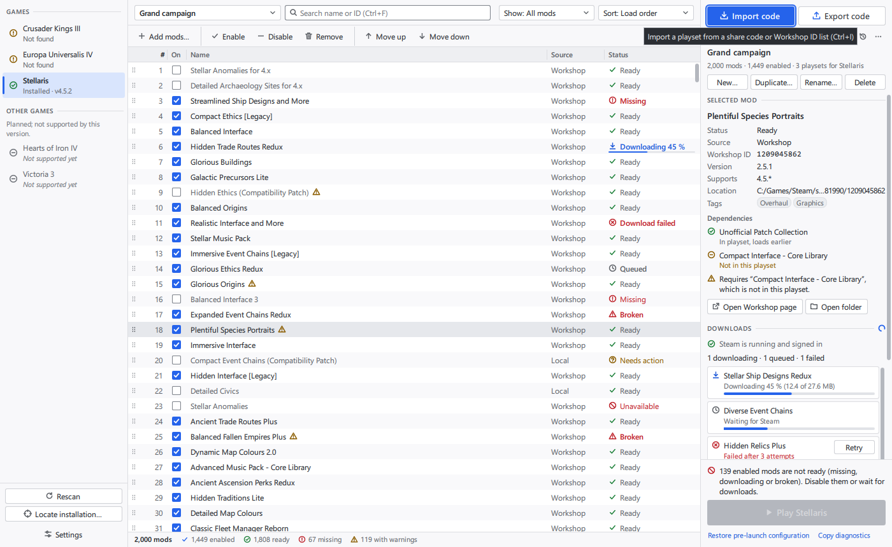
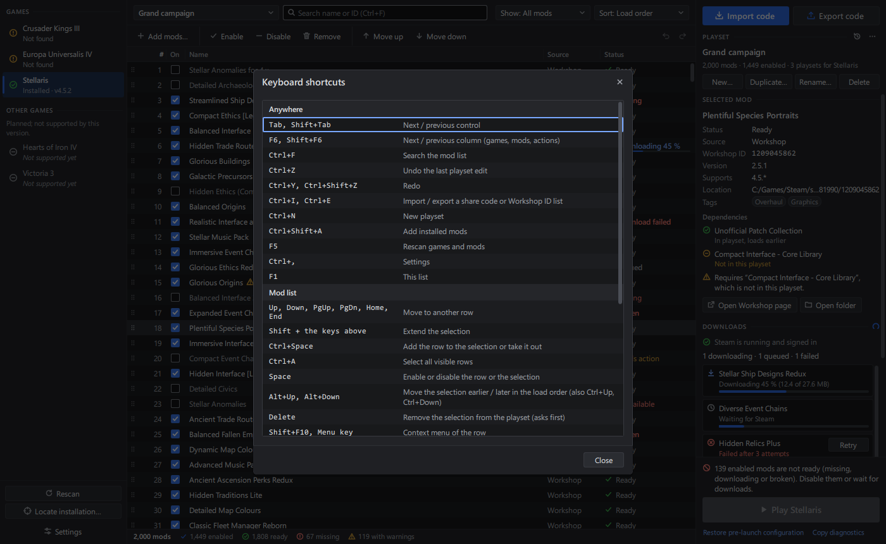
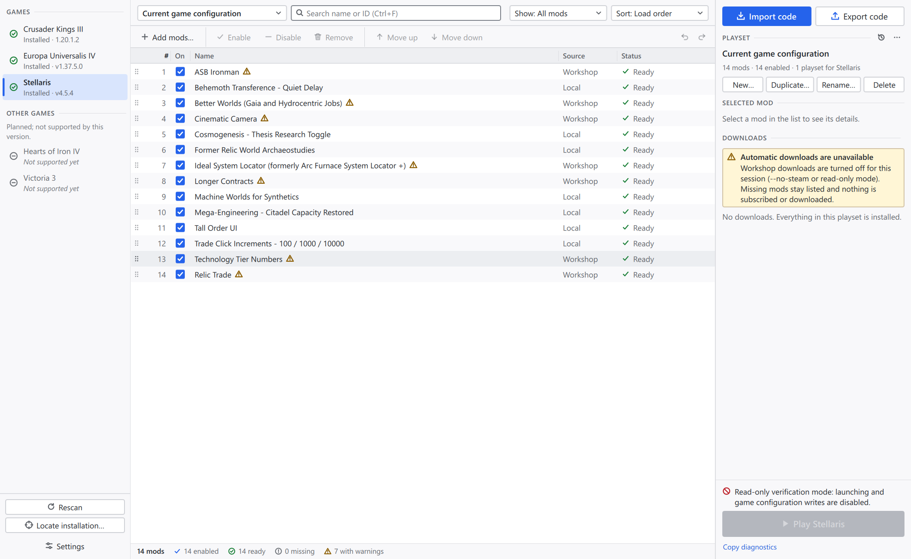
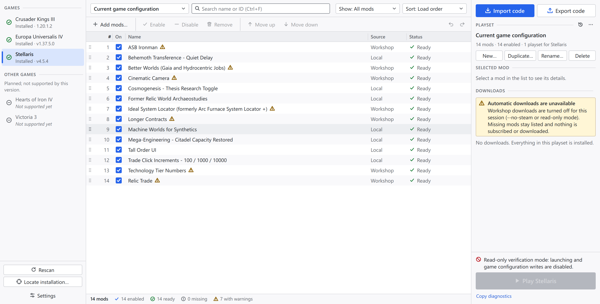

# Accessibility and high-DPI

[`spec.md`](../spec.md) section 3 asks for keyboard navigation, visible focus,
accessible labels, high-DPI support, accessible Move Up / Move Down actions,
and status that does not depend on colour alone. This page describes what the
QML user interface (`ui/`) does for each of these, how it was checked, and
what is still missing.

| Requirement | State |
| --- | --- |
| Keyboard navigation | Every action can be reached without a mouse: Tab order across the three columns, F6 between columns, list keys, shortcuts, keyboard context menu, Escape for dialogs and menus, column dividers and table columns resized with the arrow keys, Play reachable while it is unavailable |
| Visible focus | 2 px focus ring in both themes, at least 3:1 against its surroundings; shown for keyboard focus only |
| Accessible labels | Roles and names that make sense out of context ("Enable *mod*", "Move up in load order"), descriptions from the tool tips, announcements for changes that happen without a focus change |
| Move Up / Move Down | Toolbar buttons, context menu items, Alt+Up / Alt+Down and Ctrl+Up / Ctrl+Down, each announced with the new position |
| Status without colour | Every status has its own glyph shape and a text; banners and messages have an icon, text and a level word in the accessible name |
| Contrast | WCAG 2.x AA in the light and the dark theme: 4.5:1 for text, 3:1 for focus rings, control outlines and status glyphs (138 colour pairs checked) |
| High-DPI | Logical pixel sizes and vector icons; the smallest window, 900x440, fits a 1920x1080 screen at 200 %; checked at scale factors 1.5 and 2 with the real application |

## Keyboard

### Focus order

- **Tab / Shift+Tab** move left to right and top to bottom: the buttons of the
  update banner above the columns while it is shown, the games column
  (selectable games, Rescan, Locate installation, Settings, the divider to
  the mods column), the mods column (playset, search, status filter, sort,
  toolbar, banner actions, the table's column edges, the mod list), then the
  actions column (the divider to the mods column, Import / Export code,
  playset actions, detail and download actions, Play, links). Disabled and
  hidden controls are skipped. The Dismiss buttons of visible notifications
  are in the Tab order as well.
- **Play** stays in the Tab order while it is unavailable (the WAI-ARIA
  `aria-disabled` pattern): it looks disabled, its name ends in
  "unavailable", its description and tool tip give the reasons, and Enter,
  Space or a click post them as a notification ("The game cannot be started
  yet") instead of starting the game. It keeps the focus while a launch it
  started runs. Qt does not focus disabled controls, so Play is never
  disabled; the QML only calls `play()` when it can start the game.
- **F6 / Shift+F6** jump to the next / previous column: the selected game,
  the mod list, or the first enabled control of the actions column.
- Keyboard focus starts in the mod list.
- A modal dialog keeps Tab inside itself. **Esc** closes it, and focus goes
  back to the control that had it before (the button that opened the
  dialog, or the list for Delete and the shortcuts).
- A control that receives focus inside a scrolled column or list is scrolled
  into view (`Theme.reveal()`).
- In Settings → Updates, the button that was just pressed may disappear or
  become disabled ("Check for updates" while checking). Focus then moves to the
  section's main button, or back to "Check for updates", and stays in the section.
  "Check for updates automatically" is a check box (Space toggles it); its
  explanation below it is also its description.
- The update banner that the daily check shows never takes focus. Its "Not
  now" link hides it for the session and returns focus to the mod list.
- When **Recover** or **Discard this record** goes away while it has the
  focus (its banner closes after a recovery or a discard, or the discard link
  once it was used), the focus moves to the mod list.

### Column widths

The two column dividers and the four column edges of the mod table follow the
WAI-ARIA window splitter pattern: each is a focusable separator whose value is
the width of the column it resizes.

- **Left / Right** move the divider (10 pixels; with **Shift** 50), **Home**
  and **End** give the column its narrowest and widest width, **Enter** its
  default width (200 games, 300 actions; 44, 30, 90 and 150 for #, On,
  Source and Status). Left of Name an edge resizes the column on its left;
  right of Name it resizes the column on its right, since Name takes the
  remaining width, so the divider always moves the way the arrow points.
- The widths are stored exactly as after dragging (`Backend.settings`
  `leftPaneWidth`, `rightPaneWidth`, `columnWidths`), and the new width is
  announced.
- Tab order: the column dividers are two stops, each at the edge of the
  column it resizes (last in the games column, first in the actions column),
  where Tab crosses that divider anyway. The four column edges are a single
  stop right before the mod list, with roving focus: **Ctrl+Left /
  Ctrl+Right** move to the previous / next edge, and Tab and Shift+Tab come
  back to the edge used last. That adds three stops in all.
  F6 stays a jump between the three columns; making the dividers F6 stops
  would make that frequent jump slower for a rare task, and a shortcut alone
  would leave screen-reader users without a separator to find.
- The dividers draw the focus ring around the divider; in the table header,
  the edge line also turns to the accent colour.

### Shortcuts

The same list is available in the application with **F1** (also from
Settings → Keyboard shortcuts).

| Keys | Action |
| --- | --- |
| Tab, Shift+Tab | Next / previous control |
| F6, Shift+F6 | Next / previous column (games, mods, actions) |
| Ctrl+F | Search the mod list |
| Ctrl+Z | Undo the last playset edit |
| Ctrl+Y, Ctrl+Shift+Z | Redo |
| Ctrl+I, Ctrl+E | Import / export a share code |
| Ctrl+N | New playset |
| Ctrl+Shift+A | Add installed mods |
| F5 | Rescan games and mods |
| Ctrl+, | Settings |
| F1 | Keyboard shortcuts |
| **Mod list** | |
| Up, Down, PgUp, PgDn, Home, End | Move to another row |
| Shift + the keys above | Extend the selection |
| Ctrl+Space | Add the current row to the selection or take it out |
| Ctrl+A | Select all visible rows |
| Space | Enable or disable the row or the selection |
| Alt+Up, Alt+Down (also Ctrl+Up, Ctrl+Down) | Move the selection earlier / later in the load order |
| Delete | Remove the selection from the playset (asks first; undoable) |
| Shift+F10, Menu key | Context menu of the row (opens on its first item) |
| Down (in the search field) | Go to the list |
| Esc (in the search field) | Clear the search; a second Esc goes back to the list |
| **Column widths** (on a column divider or a table column edge) | |
| Left, Right | Move the divider; with Shift in larger steps |
| Home, End | Narrowest / widest column |
| Enter | Default width |
| Ctrl+Left, Ctrl+Right | Previous / next column edge of the table |
| **Games, dialogs and menus** | |
| Up, Down | Next / previous game, list row or menu item |
| Enter, Space | Select the game, activate the focused button, link or menu item |
| Esc | Close the dialog or menu |

Reordering is only possible in the unfiltered load-order view. Otherwise the
move actions are disabled, their tool tip and a banner explain why, and the
banner's "Show load order" link restores the view.

### Lists in dialogs

- **Add mods**: Down or Enter in the filter field moves to the list; Up,
  Down, Home, End, PgUp and PgDn move the current row; Space selects or
  deselects it.
- **Import preview** and **Keyboard shortcuts**: the lists are read-only but
  focusable, so the entries can be read row by row and paged.

### Focus when a dialog opens

| Dialog | Focus |
| --- | --- |
| Import share code | the share code text |
| Export share code | Copy |
| Add mods | the filter field |
| Settings | the selected theme option |
| Playset history | Close (Shift+Tab reaches the Restore buttons) |
| Locate installation | the first Browse… button |
| Remove from playset (confirmation) | the confirm button; the question is its description |
| Discard an interrupted change (confirmation) | Cancel, so Enter changes nothing; the question, with the files, is its description |
| New / duplicate / rename playset | the name field, with the text selected |
| Keyboard shortcuts | the list |

## Visible focus

- Buttons, links, combo boxes, check boxes, radio buttons and game entries
  draw a 2 px ring in `Theme.focus` (light `#2563eb`, dark `#79a8ff`) just
  outside the control. Filled controls (accent buttons, checked boxes and
  radio buttons) get a 1 px gap so the ring never merges with the fill.
- Text inputs draw a 2 px border in the focus colour.
- A focused column divider or table column edge draws the 2 px ring around
  the divider.
- Play keeps its ring while it is unavailable; its faded fill and label say
  that it cannot start the game.
- The current row of a focused list has a 2 px ring inside the row. A
  focused mod list without a current row is outlined as a whole (not at
  start-up, where focus is placed there programmatically).
- Rings follow Qt's `visualFocus`: they appear for keyboard focus, not after
  a mouse click.
- Tool tips also open on keyboard focus (after 0.6 s), so shortcut hints and
  the reasons why Play is blocked are visible without a mouse (and, since Play
  is no longer disabled, on hover too). Toolbar buttons that show only their
  icon in a narrow window keep their tool tips.

## Screen readers and UI Automation

Qt exposes the QML items to UI Automation, the Windows accessibility API,
through the `Accessible` attached properties.

### Roles and names

| Element | Role | Name (description) |
| --- | --- | --- |
| Mod row | list item | "3. *name*, enabled, Workshop, Ready" (warnings) |
| Check box in a row | check box, toggle action | "Enable *name*" |
| Warning glyph in a row | indicator | "Warnings for *name*" (the warnings) |
| Toolbar | buttons | "Add mods…", "Enable selected mods", "Disable selected mods", "Remove selected mods from playset", "Move up in load order", "Move down in load order", "Undo", "Redo" (tool tips with shortcuts) |
| Icon-only buttons | buttons | "Undo", "Redo", "Playset history", "More playset actions", "Refresh", "Dismiss notification", "Close (Esc)" |
| Playset actions | buttons | "New playset…", "Duplicate playset…", "Rename playset…", "Delete playset", "Restore deleted playset" |
| Selected mod details | static text | "Status: Ready", "Workshop ID: 1234", "Tags: Overhaul, Graphics", "*dependency*: *state*" |
| Download job | list item, progress bar, button | "*name*, Downloading 45 %"; "*name*: Downloading 45 %" (value); "Retry download of *name*" |
| History entry | list item, button | "*playset*, *reason*, *time*"; "Restore *playset* (*reason*, *time*)" |
| Banner | group | "Warning. *title*. *text*" (actions inside the group) |
| Update banner | group, button, link | "Paradox Mod Manager 1.2.3 is available." (and why this session cannot install); "Update and restart" or "Open release page"; "Not now" |
| Update check box in Settings | check box | "Check for updates automatically" (what it contacts, and when) |
| Problems and warnings | static text | "Problem: …", "Warning: …" |
| Play | button | "Play Stellaris" ("Starts the game with this playset"); while unavailable "Play Stellaris, unavailable" ("Blocked: *reasons*"); during a launch, the launch step |
| Column divider | separator | "Games column width: 200 pixels", "Actions column width: 300 pixels" (the keys) |
| Column edge in the table header | separator | "Status column width: 150 pixels" (the keys, Ctrl+Left / Ctrl+Right for the other edges) |
| Section headers, dialog titles, empty-state titles, selected mod name | heading | the text |
| Dialogs | dialog / window | the title |

Plain QML `Text` items that exist before an accessibility client connects are
not exposed by Qt 6.10, so every text the user needs (hints, counts, dialog
subtitles, empty-state explanations) sets `Accessible.role: StaticText` and
`Accessible.name` explicitly. Decorative icons, the key column of detail
grids and spinners next to self-describing text are ignored.

### Announcements

Changes that happen without a focus change are spoken with
`Accessible.announce()` (Qt 6.8 and later; UI Automation notification events):

- moves: "*name* moved to position 4", "3 mods moved up";
- Space in the mod list: "Enabled *name*", "Disabled 5 mods";
- dependency issues introduced by enabling mods;
- every notification (toast): errors and warnings interrupt, the rest are
  polite;
- error banners when they appear or change (invalid share code in the import
  preview, launch failure, interrupted configuration change);
- launch progress ("Checking installation and mods…", "Starting
  Stellaris…", "Launch failed.");
- Enter, Space or a click on an unavailable Play: the notification "The game
  cannot be started yet" with the reasons (a warning, so it interrupts);
- the new width after each key on a column divider or column edge ("310
  pixels", polite); the separator's name changes with it;
- each step of an update in Settings ("Version 1.2.3 is available.", errors),
  not every percent of the download;
- the update banner when it appears and at each step of the update it started,
  politely (its errors interrupt); the progress is not part of its text.

Banners that are announced interrupt for errors and warnings and are polite
otherwise.

Notifications disappear after 5 s (warnings 9 s, errors 15 s) unless the
pointer is over them or their Dismiss button has keyboard focus. Dismissing
one from the keyboard returns focus to the mod list.

### Status without colour

Mod and job states use distinct glyph shapes (check, clock, download arrow,
circle with exclamation mark, circle with cross, no-entry sign, question
mark, triangle) next to their text (`Theme.statusIcons`). The enabled column
shows a check mark, and the import preview a check mark or a dash. Banners
and messages pair an icon with text, and their accessible names start with
"Error", "Warning" or "Problem". The footer counts are text.

## Contrast

Ratios are WCAG 2.x relative-luminance contrast ratios computed from the
`Theme.qml` palettes by `python3 ui/dev/check_contrast.py`, which checks 69
foreground/background pairs per theme and fails when one is below its
minimum. All 138 pass. Selected pairs:

| Pair | Light | Dark | Minimum |
| --- | --- | --- | --- |
| text on list / pane | 15.80 / 14.89 | 13.94 / 12.44 | 4.5 |
| text on a selected row | 12.47 | 9.76 | 4.5 |
| muted text on list / pane / selected row | 6.33 / 5.96 / 4.99 | 7.03 / 6.27 / 4.92 | 4.5 |
| faint text (placeholders, hints) on list / pane | 4.84 / 4.56 | 5.35 / 4.77 | 4.5 |
| accent button label | 5.17 | 4.79 | 4.5 |
| link on pane | 5.76 | 6.62 | 4.5 |
| warning text on list / selected row | 5.81 / 4.59 | 7.66 / 5.37 | 4.5 |
| error text on list / selected row | 6.20 / 4.89 | 6.92 / 4.84 | 4.5 |
| focus ring on list / pane / selected row | 5.17 / 4.87 / 4.08 | 7.42 / 6.62 / 5.20 | 3 |
| check box, radio button and input outline on input / selected row | 3.87 / 3.05 | 4.87 / 3.28 | 3 |
| checked check box on a selected row | 4.08 | 3.10 | 3 |

This pass changed the palette where pairs failed: faint text was 2.7–3.8:1,
white on the dark accent 3.97:1 (3.38:1 hovered), light warning and error
text on selected rows 3.84:1 and 4.38:1, dark error text on selected rows
4.43:1, and unchecked check box, radio button and input outlines about 2:1.
`Theme.controlBorder` and `Theme.controlChecked` are the colours for control
outlines and checked fills. Disabled controls are exempt and stay faded.

## High-DPI

- All sizes in the QML are logical pixels. Qt scales them by the device pixel
  ratio of each screen (Windows per-monitor DPI, `QT_SCALE_FACTOR`).
- Icons are vector paths on a 16x16 grid (`ui/controls/IconPaths.js`) drawn
  with `QtQuick.Shapes` and the curve renderer; there are no bitmaps. Text
  uses the system font at scaled pixel sizes.
- Check on 2026-10-29 with the real application (Stellaris 4.5.2, playset
  from the game's configuration, scratch profile, `--read-only`, Windows 11,
  2560x1440 screen at 100 %): `QT_SCALE_FACTOR=1.5` and `2`. `--screenshot`
  forces scale factor 1 for reproducible captures, so the window was captured
  with `PrintWindow` instead.
  - 1.5: 2100x1290 pixels. No clipped or overlapping text, sharp icons and
    focus rings; the Add mods dialog was also checked.
  - 2: Windows limits the window to the screen, so it ran at 1400x710
    logical pixels (2800x1421). The layout still fits; the lists scroll.
- Since 2026-11-12 `--screenshot` keeps an explicitly set `QT_SCALE_FACTOR`
  (without one it still uses 1), and `--window-size <w>x<h>` sets the
  window's logical size ([`app.md`](app.md#hidden-verification-switches)),
  so high-DPI captures are reproducible:
  `QT_SCALE_FACTOR=2 pmm-app --profile <new folder> --screenshot shot.png --window-size 1x1`
  captures the smallest window at 1800x880 pixels.

### Smallest window

The window's minimum size is 900x440 logical pixels (980x600 before
2026-11-12). A maximized window on a 1920x1080 screen at 200 % has about
960x470 logical pixels for its content (960x540 less the taskbar and the
title bar), on 1366x768 at 150 % about 911x441. The column minimums are 160
(games), 460 (mods) and 250 (actions): 872 pixels with the dividers. When the
window narrows, the actions column and then the games column give way down to
their minimums, so the mods column keeps 460; the widths chosen by dragging or
with the keyboard are stored, not the squeezed ones, and come back in a wider
window.

In a small window:

- the toolbar above the mod list shows icons only when its labels do not fit
  (the names stay in the tool tips and for screen readers); the status filter
  and sort lists drop their "Show:" and "Sort:" prefixes and share the header
  row with the playset selector and the search field; Name keeps at least
  120 pixels;
- the four playset buttons wrap onto two rows, and button labels that do not
  fit are elided instead of running over the button's edge;
- the actions column scrolls as a whole when the share buttons, the playset
  section, 90 pixels of details and the Play section with its banners and
  reasons do not fit. Tab scrolls the focused control into view, so Play and
  its reasons are always reachable;
- dialogs are never taller than the window less 32 pixels; Settings, the
  import preview, confirmations and the lists in dialogs scroll.

Checked on 2026-11-12 (Windows 11, 2560x1440 screen at 100 %): the preview
with the fake backend at 900x440 in both themes, with Play blocked (mods not
ready; also with Steam not running and an interrupted change, where the
actions column scrolls) and with Play available (no playset), and every
dialog; and the real application, read-only, with a new scratch profile and a
playset from Stellaris's configuration, at `--window-size 1x1` with
`QT_SCALE_FACTOR` 1 (900x440) and 2 (1800x880), light and dark. Nothing was
clipped, and Play with its reason (the read-only blocker) was visible.

## Verification

Automated:

- `ui/dev/preview.sh --test` (fake backend, 30 tests; ctest runs them too, as
  `pmm_ui_preview` with the label `ui-preview`, so `scripts/check.sh` and the
  release's CI include them): besides the editing
  tests, Tab visits the actions, games and mods columns in that order and
  returns to the list; F6 / Shift+F6; Enter opens Settings from its button,
  Tab stays inside the dialog and Esc returns focus to the button; Esc on the
  remove confirmation keeps the rows and focuses the list; Alt+Up/Down
  reorder and undo; Shift+F10 opens the context menu on "Enable" and Esc
  returns to the same row; Ctrl+Space; F1 list paging; the accessible name of
  the current row; the update banner leaves focus in the list, Tab reaches "Not
  now" and Enter there hides the banner and returns focus to the list;
  discarding an interrupted change from the keyboard (Enter on the link, Tab
  from Cancel to Discard, Enter) returns focus to the list; Tab reaches a
  blocked Play, whose name and description say why, Enter, Space and a click
  post the reasons and start nothing, and once nothing blocks the same key
  starts the game; the column edges and the dividers resize with the arrow
  keys, Shift, Home, End and Enter, and the widths are stored; the smallest
  window fits its columns and Tab scrolls Play into view while the actions
  column scrolls.
- `ctest --preset debug -R Pmm.Ui` (real Backend, offscreen window, key events
  through `QTest`): Tab order, F6, Alt+Up/Down and Ctrl+Up/Down with undo, Esc
  on the confirmation, the context menu and the shortcuts list with focus
  return, without QML warnings. The `[qml][update]` cases: the Updates section
  and its check box with the keyboard at the smallest window size, the update
  banner's names, Tab order, Enter and "Not now". Since 2026-11-12: a blocked
  Play reached with Tab (name, description, tool tip; Enter, Space and a
  click post the reasons and start no process; the same key launches once
  Steam runs), keyboard resizing of both dividers and the column edges with
  the stored widths, the smallest window (column geometry, the header row
  inside the mods column, the scrolling actions column with Play scrolled
  into view by Tab), and restoring a window saved at the smallest size.
- `python3 ui/dev/check_contrast.py`: 138 colour pairs.

UI Automation inspection on 2026-10-29 (Windows `System.Windows.Automation`
client against the running application, read-only, scratch profile; control
and raw views; Settings opened through its Invoke pattern):

- The window, the controls of all three columns and the 17 mod rows were
  listed with the names above; each row had a "Enable *mod*" check box and,
  where applicable, a "Warnings for *mod*" indicator. Toolbar buttons without
  a selection and the blocked Play button were reported disabled.
- Keyboard focus was reported on the list "Mods in playset …" after start-up
  and on the radio button "Follow system" in Settings.
- Before the fixes in this pass, hints such as "Select a mod in the list to
  see its details." were missing from the tree and banners appeared as nested
  windows; both were corrected and checked again.

Not performed: listening tests with NVDA, Narrator or JAWS, and Windows
high-contrast themes. The announcements
were checked to run without errors, not heard.

## Known gaps

- No screen-reader listening test yet (see above). It should also settle
  how the new pieces sound: Play's "unavailable" name and its notification,
  and whether the separators' width is read once or twice (their name
  changes and an announcement follows each key).
- Play cannot report UI Automation's disabled state while it keeps the focus
  (Qt Quick sets it only for disabled items), so "unavailable" is part of its
  name instead.
- The column dividers and edges are separators without a UI Automation range
  value (Qt Quick gives one only to sliders, spin boxes, scroll bars, dials
  and progress bars): the width is in their name and announced.
- Drag and drop has keyboard equivalents (Alt+Up/Down, Move to top / bottom
  in the context menu) but no keyboard pick-up-and-drop.
- Ctrl+Up/Down move rows, so the current row cannot move without changing
  the selection; non-contiguous selections need Ctrl+click or Ctrl+Space on
  rows reached by moving the selection.
- Windows high-contrast themes and system colours are not followed; the
  application uses its own light and dark palettes.
- Text size follows display scaling only, not a separate text-size setting.
- The smallest window, 900x440, fits a maximized window at 200 % on
  1920x1080 and at 150 % on 1366x768 with Windows' standard 48-pixel
  taskbar; a taller taskbar or title bar leaves a few pixels of the footer
  below the screen at 1366x768.
- UI Automation reports static texts as keyboard-focusable (Qt marks
  static text focusable so touch screen readers can reach it); they are not
  in the Tab order. Dialog footers come before the dialog content in the UI
  Automation child order; visual and Tab order are correct.
- Descriptions (the tool tip texts, e.g. shortcuts and Play blockers) did not
  appear as UI Automation `HelpText` in the inspection; Qt hands them to UI
  Automation as a separate description property, which the managed client
  used here cannot read. Whether NVDA and Narrator read them is unverified;
  the essential information is also in the names or in visible text.
