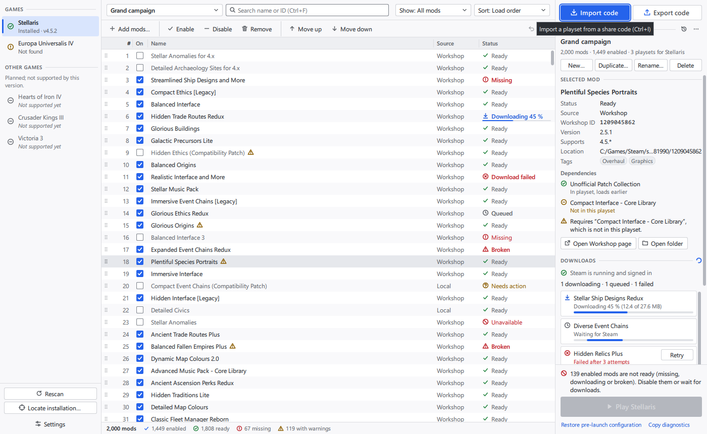
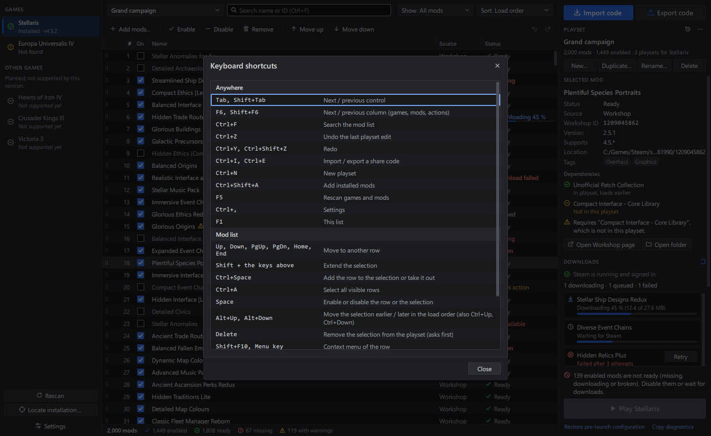
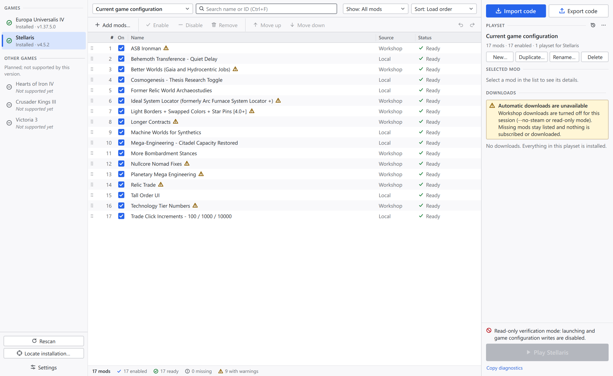
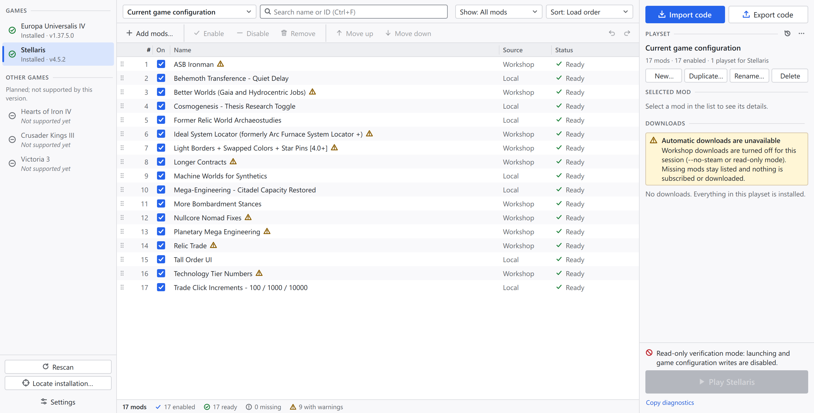

# Accessibility and high-DPI

[`spec.md`](../spec.md) section 3 asks for keyboard navigation, visible focus,
accessible labels, high-DPI support, accessible Move Up / Move Down actions,
and status that does not depend on colour alone. This page describes what the
QML user interface (`ui/`) does for each of these, how it was checked, and
what is still missing.

| Requirement | State |
| --- | --- |
| Keyboard navigation | Every action can be reached without a mouse: Tab order across the three columns, F6 between columns, list keys, shortcuts, keyboard context menu, Escape for dialogs and menus |
| Visible focus | 2 px focus ring in both themes, at least 3:1 against its surroundings; shown for keyboard focus only |
| Accessible labels | Roles and names that make sense out of context ("Enable *mod*", "Move up in load order"), descriptions from the tool tips, announcements for changes that happen without a focus change |
| Move Up / Move Down | Toolbar buttons, context menu items, Alt+Up / Alt+Down and Ctrl+Up / Ctrl+Down, each announced with the new position |
| Status without colour | Every status has its own glyph shape and a text; banners and messages have an icon, text and a level word in the accessible name |
| Contrast | WCAG 2.x AA in the light and the dark theme: 4.5:1 for text, 3:1 for focus rings, control outlines and status glyphs (138 colour pairs checked) |
| High-DPI | Logical pixel sizes and vector icons; checked at scale factors 1.5 and 2 with the real application |

## Keyboard

### Focus order

- **Tab / Shift+Tab** move left to right and top to bottom: the games column
  (selectable games, Rescan, Locate installation, Settings), the mods column
  (playset, search, status filter, sort, toolbar, banner actions, the mod
  list), then the actions column (Import / Export code, playset actions,
  detail and download actions, Play, links). Disabled and hidden controls are
  skipped. The Dismiss buttons of visible notifications are in the Tab order
  as well.
- **F6 / Shift+F6** jump to the next / previous column: the selected game,
  the mod list, or the first enabled control of the actions column.
- Keyboard focus starts in the mod list.
- A modal dialog keeps Tab inside itself. **Esc** closes it, and focus goes
  back to the control that had it before (the button that opened the
  dialog, or the list for Delete and the shortcuts).
- A control that receives focus inside a scrolled column or list is scrolled
  into view (`Theme.reveal()`).

### Shortcuts

The same list is available in the application with **F1** (also from
Settings → Keyboard shortcuts).

| Keys | Action |
| --- | --- |
| Tab, Shift+Tab | Next / previous control |
| F6, Shift+F6 | Next / previous column (games, mods, actions) |
| Ctrl+F | Search the mod list |
| Ctrl+Z | Undo the last playset edit |
| Ctrl+Y, Ctrl+Shift+Z | Redo |
| Ctrl+I, Ctrl+E | Import / export a share code |
| Ctrl+N | New playset |
| Ctrl+Shift+A | Add installed mods |
| F5 | Rescan games and mods |
| Ctrl+, | Settings |
| F1 (also Cmd+? on macOS) | Keyboard shortcuts |
| **Mod list** | |
| Up, Down, PgUp, PgDn, Home, End | Move to another row |
| Shift + the keys above | Extend the selection |
| Ctrl+Space | Add the current row to the selection or take it out |
| Ctrl+A | Select all visible rows |
| Space | Enable or disable the row or the selection |
| Alt+Up, Alt+Down (also Ctrl+Up, Ctrl+Down) | Move the selection earlier / later in the load order |
| Delete | Remove the selection from the playset (asks first; undoable) |
| Shift+F10, Menu key | Context menu of the row (opens on its first item) |
| Down (in the search field) | Go to the list |
| Esc (in the search field) | Clear the search; a second Esc goes back to the list |
| **Games, dialogs and menus** | |
| Up, Down | Next / previous game, list row or menu item |
| Enter, Space | Select the game, activate the focused button, link or menu item |
| Esc | Close the dialog or menu |

Reordering is only possible in the unfiltered load-order view. Otherwise the
move actions are disabled, their tool tip and a banner explain why, and the
banner's "Show load order" link restores the view.

### Lists in dialogs

- **Add mods**: Down or Enter in the filter field moves to the list; Up,
  Down, Home, End, PgUp and PgDn move the current row; Space selects or
  deselects it.
- **Import preview** and **Keyboard shortcuts**: the lists are read-only but
  focusable, so the entries can be read row by row and paged.

### Focus when a dialog opens

| Dialog | Focus |
| --- | --- |
| Import share code | the share code text |
| Export share code | Copy |
| Add mods | the filter field |
| Settings | the selected theme option |
| Playset history | Close (Shift+Tab reaches the Restore buttons) |
| Locate installation | the first Browse… button |
| Remove from playset (confirmation) | the confirm button; the question is its description |
| New / duplicate / rename playset | the name field, with the text selected |
| Keyboard shortcuts | the list |

## Visible focus

- Buttons, links, combo boxes, check boxes, radio buttons and game entries
  draw a 2 px ring in `Theme.focus` (light `#2563eb`, dark `#79a8ff`) just
  outside the control. Filled controls (accent buttons, checked boxes and
  radio buttons) get a 1 px gap so the ring never merges with the fill.
- Text inputs draw a 2 px border in the focus colour.
- The current row of a focused list has a 2 px ring inside the row. A
  focused mod list without a current row is outlined as a whole (not at
  start-up, where focus is placed there programmatically).
- Rings follow Qt's `visualFocus`: they appear for keyboard focus, not after
  a mouse click.
- Tool tips also open on keyboard focus (after 0.6 s), so shortcut hints and
  the reasons why Play is blocked are visible without a mouse.

## Screen readers and UI Automation

Qt exposes the QML items to the platform accessibility API (UI Automation on
Windows, AT-SPI on Linux, NSAccessibility on macOS) through the `Accessible`
attached properties.

### Roles and names

| Element | Role | Name (description) |
| --- | --- | --- |
| Mod row | list item | "3. *name*, enabled, Workshop, Ready" (warnings) |
| Check box in a row | check box, toggle action | "Enable *name*" |
| Warning glyph in a row | indicator | "Warnings for *name*" (the warnings) |
| Toolbar | buttons | "Add mods…", "Enable selected mods", "Disable selected mods", "Remove selected mods from playset", "Move up in load order", "Move down in load order", "Undo", "Redo" (tool tips with shortcuts) |
| Icon-only buttons | buttons | "Undo", "Redo", "Playset history", "More playset actions", "Refresh", "Dismiss notification", "Close (Esc)" |
| Playset actions | buttons | "New playset…", "Duplicate playset…", "Rename playset…", "Delete playset", "Restore deleted playset" |
| Selected mod details | static text | "Status: Ready", "Workshop ID: 1234", "Tags: Overhaul, Graphics", "*dependency*: *state*" |
| Download job | list item, progress bar, button | "*name*, Downloading 45 %"; "*name*: Downloading 45 %" (value); "Retry download of *name*" |
| History entry | list item, button | "*playset*, *reason*, *time*"; "Restore *playset* (*reason*, *time*)" |
| Banner | group | "Warning. *title*. *text*" (actions inside the group) |
| Problems and warnings | static text | "Problem: …", "Warning: …" |
| Section headers, dialog titles, empty-state titles, selected mod name | heading | the text |
| Dialogs | dialog / window | the title |

Plain QML `Text` items that exist before an accessibility client connects are
not exposed by Qt 6.10, so every text the user needs (hints, counts, dialog
subtitles, empty-state explanations) sets `Accessible.role: StaticText` and
`Accessible.name` explicitly. Decorative icons, the key column of detail
grids and spinners next to self-describing text are ignored.

### Announcements

Changes that happen without a focus change are spoken with
`Accessible.announce()` (Qt 6.8 and later; UI Automation notification events
on Windows):

- moves: "*name* moved to position 4", "3 mods moved up";
- Space in the mod list: "Enabled *name*", "Disabled 5 mods";
- dependency issues introduced by enabling mods;
- every notification (toast): errors and warnings interrupt, the rest are
  polite;
- error banners when they appear or change (invalid share code in the import
  preview, launch failure, interrupted configuration change);
- launch progress ("Checking installation and mods…", "Starting
  Stellaris…", "Launch failed.").

Notifications disappear after 5 s (warnings 9 s, errors 15 s) unless the
pointer is over them or their Dismiss button has keyboard focus. Dismissing
one from the keyboard returns focus to the mod list.

### Status without colour

Mod and job states use distinct glyph shapes (check, clock, download arrow,
circle with exclamation mark, circle with cross, no-entry sign, question
mark, triangle) next to their text (`Theme.statusIcons`). The enabled column
shows a check mark, and the import preview a check mark or a dash. Banners
and messages pair an icon with text, and their accessible names start with
"Error", "Warning" or "Problem". The footer counts are text.

## Contrast

Ratios are WCAG 2.x relative-luminance contrast ratios computed from the
`Theme.qml` palettes by `python3 ui/dev/check_contrast.py`, which checks 69
foreground/background pairs per theme and fails when one is below its
minimum. All 138 pass. Selected pairs:

| Pair | Light | Dark | Minimum |
| --- | --- | --- | --- |
| text on list / pane | 15.80 / 14.89 | 13.94 / 12.44 | 4.5 |
| text on a selected row | 12.47 | 9.76 | 4.5 |
| muted text on list / pane / selected row | 6.33 / 5.96 / 4.99 | 7.03 / 6.27 / 4.92 | 4.5 |
| faint text (placeholders, hints) on list / pane | 4.84 / 4.56 | 5.35 / 4.77 | 4.5 |
| accent button label | 5.17 | 4.79 | 4.5 |
| link on pane | 5.76 | 6.62 | 4.5 |
| warning text on list / selected row | 5.81 / 4.59 | 7.66 / 5.37 | 4.5 |
| error text on list / selected row | 6.20 / 4.89 | 6.92 / 4.84 | 4.5 |
| focus ring on list / pane / selected row | 5.17 / 4.87 / 4.08 | 7.42 / 6.62 / 5.20 | 3 |
| check box, radio button and input outline on input / selected row | 3.87 / 3.05 | 4.87 / 3.28 | 3 |
| checked check box on a selected row | 4.08 | 3.10 | 3 |

This pass changed the palette where pairs failed: faint text was 2.7–3.8:1,
white on the dark accent 3.97:1 (3.38:1 hovered), light warning and error
text on selected rows 3.84:1 and 4.38:1, dark error text on selected rows
4.43:1, and unchecked check box, radio button and input outlines about 2:1.
`Theme.controlBorder` and `Theme.controlChecked` are the colours for control
outlines and checked fills. Disabled controls are exempt and stay faded.

## High-DPI

- All sizes in the QML are logical pixels. Qt scales them by the device pixel
  ratio of each screen (Windows per-monitor DPI, `QT_SCALE_FACTOR`).
- Icons are vector paths on a 16x16 grid (`ui/controls/IconPaths.js`) drawn
  with `QtQuick.Shapes` and the curve renderer; there are no bitmaps. Text
  uses the system font at scaled pixel sizes.
- Check on 2026-10-29 with the real application (Stellaris 4.5.2, playset
  from the game's configuration, scratch profile, `--read-only`, Windows 11,
  2560x1440 screen at 100 %): `QT_SCALE_FACTOR=1.5` and `2`. `--screenshot`
  forces scale factor 1 for reproducible captures, so the window was captured
  with `PrintWindow` instead.
  - 1.5: 2100x1290 pixels. No clipped or overlapping text, sharp icons and
    focus rings; the Add mods dialog was also checked.
  - 2: Windows limits the window to the screen, so it ran at 1400x710
    logical pixels (2800x1421). The layout still fits; the lists scroll.

## Verification

Automated:

- `ui/dev/preview.sh --test` (fake backend, 21 tests): besides the editing
  tests, Tab visits the actions, games and mods columns in that order and
  returns to the list; F6 / Shift+F6; Enter opens Settings from its button,
  Tab stays inside the dialog and Esc returns focus to the button; Esc on the
  remove confirmation keeps the rows and focuses the list; Alt+Up/Down
  reorder and undo; Shift+F10 opens the context menu on "Enable" and Esc
  returns to the same row; Ctrl+Space; F1 list paging; the accessible name of
  the current row.
- `ctest --preset debug -R Pmm.Ui` (real Backend, offscreen window, key events
  through `QTest`): Tab order, F6, Alt+Up/Down and Ctrl+Up/Down with undo, Esc
  on the confirmation, the context menu and the shortcuts list with focus
  return, without QML warnings.
- `python3 ui/dev/check_contrast.py`: 138 colour pairs.

UI Automation inspection on 2026-10-29 (Windows `System.Windows.Automation`
client against the running application, read-only, scratch profile; control
and raw views; Settings opened through its Invoke pattern):

- The window, the controls of all three columns and the 17 mod rows were
  listed with the names above; each row had a "Enable *mod*" check box and,
  where applicable, a "Warnings for *mod*" indicator. Toolbar buttons without
  a selection and the blocked Play button were reported disabled.
- Keyboard focus was reported on the list "Mods in playset …" after start-up
  and on the radio button "Follow system" in Settings.
- Before the fixes in this pass, hints such as "Select a mod in the list to
  see its details." were missing from the tree and banners appeared as nested
  windows; both were corrected and checked again.

Not performed: listening tests with NVDA, Narrator or JAWS, VoiceOver on
macOS and Orca on Linux, and Windows high-contrast themes. The announcements
were checked to run without errors, not heard.

## Known gaps

- No screen-reader listening test yet (see above).
- The Play button cannot take focus while it is disabled (Qt does not focus
  disabled controls). The blocking reasons are static texts right above it
  and in its description, reachable with screen-reader navigation, not with
  Tab.
- Column widths and the column dividers can only be resized with the mouse.
  The defaults work; Name takes the remaining width.
- Drag and drop has keyboard equivalents (Alt+Up/Down, Move to top / bottom
  in the context menu) but no keyboard pick-up-and-drop.
- Ctrl+Up/Down move rows, so the current row cannot move without changing
  the selection; non-contiguous selections need Ctrl+click or Ctrl+Space on
  rows reached by moving the selection.
- Windows high-contrast themes and system colours are not followed; the
  application uses its own light and dark palettes.
- Text size follows display scaling only, not a separate text-size setting.
- The minimum window size, 980x600 logical pixels, is larger than a
  1920x1080 screen at 200 % (960x540).
- UI Automation reports static texts as keyboard-focusable (Qt marks
  static text focusable so touch screen readers can reach it); they are not
  in the Tab order. Dialog footers come before the dialog content in the UI
  Automation child order; visual and Tab order are correct.
- Descriptions (the tool tip texts, e.g. shortcuts and Play blockers) did not
  appear as UI Automation `HelpText` in the inspection; Qt hands them to UI
  Automation as a separate description property, which the managed client
  used here cannot read. Whether NVDA and Narrator read them is unverified;
  the essential information is also in the names or in visible text.
