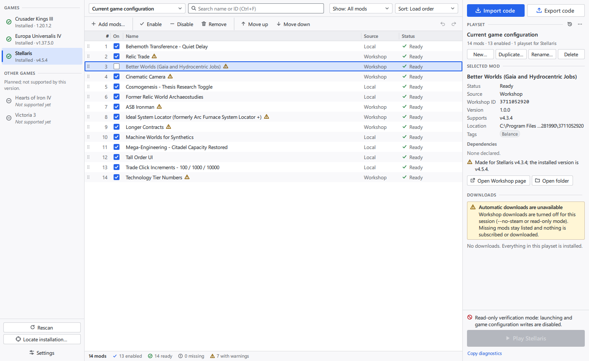

# Desktop application (`src/app`)

`pmm-app` is the Qt Quick desktop application. It composes the Qt-free
services ([`architecture-services.md`](architecture-services.md)) with the QML
user interface in `ui/` ([`ui-contract.md`](ui-contract.md)).



## Targets

| Target | Location | Qt modules | Contents |
| --- | --- | --- | --- |
| `pmm_appcore` | `src/app/core` | Core, Network | `AppRuntime` (composition root), `ServiceRunner` (worker thread), `QtWorkshopSessionHost`, `QtWorkshopMetadataHost`, `FileLogSink`, GUI-ready snapshots (`view_data.hpp`) |
| `pmm_appgui` | `src/app/gui` | Gui, Qml | `Backend` and the models and controllers of the UI contract |
| `pmm-app` | `src/app/gui/main.cpp` | Quick, QuickControls2 | start-up, command line, fatal error window, verification switches (`verification.cpp`) |

`pmm_appcore` has no GUI dependency; tests use `AppRuntime` and
`ServiceRunner` without a window. `pmm-app` is the only front end (there is no
command-line tool; the verification switches below cover headless use). It is
written to `<build>/bin`, next to `pmm-steam-helper`, as in the packages.

## Processes and threads

```text
 pmm-app process
 +------------------------------------------+     +----------------------------------------+
 | GUI thread                               |     | services worker thread ("pmm-services")|
 |  QML (Pmm.Ui)                            |     |  AppRuntime                            |
 |   binds to Backend.<object>              |     |   ServiceContext, Database, journal    |
 |  Backend + models + controllers          |call |   GameService, PlaysetService,         |
 |   optimistic edits (core/playset_ops) ---+---->|   ShareService, LaunchService          |
 |   incremental model updates  <-----------+-----|   AcquisitionCoordinator               |
 |                                  results |     |  QtWorkshopSessionHost (QProcess)  ----+--> pmm-steam-helper
 |                                          |     |  QtWorkshopMetadataHost (QNetworkAM) --+--> Steam Web API
 |  acquisitionChanged / processStarting <--+-----|  QTimer ~1 s -> coordinator.tick()     |    (key-less, metadata)
 +------------------------------------------+     +----------------------------------------+
                                                    LaunchService -> platform::startDetached -> game
```

- **One worker thread** owns everything that touches services: the runtime,
  both hosts, the coordinator and its tick timer. Services are synchronous
  and not thread-safe; running them on one thread keeps them simple and
  ordered. The GUI thread never calls a service.
- **`ServiceRunner::call(receiver, fn, done)`** runs `fn(AppRuntime&)` on the
  worker and `done(result)` queued on the GUI thread. Calls run in submission
  order. A `done` whose receiver was destroyed is dropped. `callBlocking()`
  exists for start-up and tests only.
- **Results are snapshots** (`GameContextData`, `PlaysetStateData`,
  `LaunchData`, `AcquisitionData`, ...), built on the worker with strings
  already converted to `QString`. The models apply them as incremental
  updates: `dataChanged` for changed rows, `rowsInserted`/`rowsRemoved` for
  added and removed entries. Only switching to another playset resets the
  mod list.
- **Edits are optimistic.** `ModListModel` applies an edit at once with the
  same core functions the services use (`core/playset_ops`), then sends it to
  `PlaysetService`. The worker returns the authoritative state, which is
  reconciled once no other edit is in flight. Edits name their rows by
  identity, and the worker applies an edit to all of them or, when an undo or
  redo still in flight has taken one away, to none. Refused edits are reverted
  by that state and explained in a notification.
- **Reorders reach the view as `dataChanged`.** `QSortFilterProxyModel` turns
  source row moves into a layout change without a hint. A QML `ListView`
  then rebuilds its delegates and scrolls back to the top. The QML re-selects
  the moved rows itself.
- **Coordinator events** (helper output, helper exit, Web API replies, ticks)
  arrive on the worker and go straight to the coordinator. When job states
  change, `ServiceRunner::acquisitionChanged` makes the Backend refresh the
  downloads, the affected playset rows and the launch verdict, coalesced to
  one request at a time.
- **A launch changes job states without a coordinator event.** It closes the
  game's helper session and parks its downloads; when the game cannot be
  started after that, they resume. `LaunchController::play()` therefore asks
  for the same refresh (`Backend::refreshAcquisition()`) after every outcome,
  so the downloads and the playset rows show the parked or resumed jobs at
  once.
- **Processes come and go without an event.** The launch verdict is also
  refreshed when the window is activated (at most every 5 s) and 4 s and 15 s
  after a launch. While it is blocked because Steam is not running, or the
  game or the Paradox launcher is (`LaunchData::steamNotRunning`,
  `runningInstance`), the Backend checks again every
  `BackendOptions::launchRecheckMs` (3 s): one check at a time on the worker,
  without the write probes (as in a read-only session, so nothing is created
  in the game's folders every few seconds). When that check changes either
  flag, the full launch check runs and its verdict is shown, so Play becomes
  available on its own once Steam has started or the game has closed. The
  re-checks stop when neither flag is set, when another game is selected, and
  never run in read-only sessions. Pressing Play still checks again on the
  worker.

### Steam helper host

`QtWorkshopSessionHost` runs one `pmm-steam-helper --app-id <id> --steam-api
<library>` per game:

- The helper is looked up next to the executable
  (`QCoreApplication::applicationDirPath()`). The `PMM_STEAM_HELPER`
  environment variable overrides this for development.
- It starts with `CREATE_NO_WINDOW`. The process-wide error mode
  set by `main()` is inherited.
- Commands are written to stdin. Stdout is split with
  `providers::LineSplitter` and decoded with `providers::decodeEvent()`;
  undecodable lines are logged and skipped. Stderr can contain the user's
  SteamID, so it is logged at debug level only, with SteamIDs and personal
  paths redacted.
- All process signals use queued connections and are checked against a
  per-session serial number. Nothing is delivered re-entrantly from
  `open()`, `send()` or `close()`, and nothing of a session arrives after
  `close()`.
- `close()` sends `QuitCommand`, closes stdin and kills the process if it is
  still running after 3 s. A new session first waits for the closed helpers
  to exit.
- Before a launch, the coordinator calls `waitUntilClosed(game)`: it waits up
  to 3 s for that game's closed helper (other games' helpers keep exiting on
  their own), then kills it, logs a warning and waits up to 1 s more. It runs
  no event loop, so nothing is delivered meanwhile, and the launch goes ahead
  either way.

### Web API host

`QtWorkshopMetadataHost` posts `providers::buildPublishedFileDetailsRequest()`
to `https://api.steampowered.com/ISteamRemoteStorage/GetPublishedFileDetails/v1/`:

- It sends no API key and no cookies, and collects no telemetry. The headers
  are fixed, so nothing in a request depends on the computer: it sends
  `Accept-Language: en` instead of the system's language, which Qt would add.
- Requests time out after 15 s. Replies larger than the parser's limit are
  aborted.
- `PMM_WORKSHOP_METADATA_URL` overrides the endpoint (tests, local stubs);
  `RunnerOptions::metadataEndpoint` does the same for tests.
- It runs for acquisition jobs (names and the identity gate) and for import
  previews. `request()` answers the coordinator through its sink, and a
  failed request is logged and not answered (offline operation).
  `lookup()` answers only its own caller, exactly once, failures included.

#### Workshop names in the import preview

When a preview (of a share code or a Workshop ID list) has Workshop mods that
are not installed, their item ids are sent, in the request body, with the
fixed headers above. That happens once the preview has settled: 600 ms after
it was built, and the dialog builds it 350 ms after the last change, so about
a second after typing stops.

- At most 1,000 ids per preview, in requests of at most 100
  (`ServiceRunner::lookupWorkshopItems()`); answers are cached for the
  session, so previewing the same text again sends nothing.
- The answers show the Workshop titles and mark items that were not found
  (deleted, private or friends-only), are banned or belong to another game.
  A title replaces the text's own name hint and is stored with the imported
  playset; if the playset is confirmed before the answer arrives, it is
  stored without.
- Preview answers go only to the preview, never to the coordinator, so they
  neither reject nor confirm an acquisition job.
- After 20 s without an answer the preview says the Steam Workshop could not
  be reached and shows the ids; importing works either way.
- Sessions without Steam (`--no-steam`, `--read-only` and the verification
  switches) have no Web API host, so neither the preview's nor the
  acquisition's requests happen. Read-only sessions never look anything up.

### Updates

`UpdateClient` and `UpdateController` run on the GUI thread, with their own
`QNetworkAccessManager`: nothing in them blocks. They touch the network after a
click in Settings, and for the daily check: `Backend` schedules it when the
start-up refresh has finished, and about 10 s later the same single request as
the button runs, if "Check for updates automatically" is on and no daily check
got an answer on the current local date. Read-only and verification sessions
never run it. A newer version is offered in a banner above the columns; nothing
is downloaded until "Update and restart" is pressed. Sessions started with
`--profile` or `--no-steam` offer the release page instead of installing,
because the installer restarts the application without arguments.

`main()` holds the named mutex `Local\ParadoxModManagerRunning` for the whole
process (`RunningInstanceSignal`), which is what an update run's installer waits for.
The log records at start-up whether this copy updates through the installer or the
release page. What is contacted, verified and protected against is in
[`updates.md`](updates.md).

## Start-up sequence

1. `main()` sets the Windows error mode (`SEM_FAILCRITICALERRORS |
   SEM_NOGPFAULTERRORBOX | SEM_NOOPENFILEERRORBOX`), creates the
   `QGuiApplication`, selects the Basic Quick Controls style and parses the
   command line.
2. `main()` takes the profile lock (`ProfileLock`, a `QLockFile` on
   `<data folder>/pmm-app.lock`) and holds it until the runner has shut down.
   The journal, the acquisition jobs and the Steam helper sessions assume one
   instance per profile. A second start on the same profile waits up to 2 s
   for the lock, then shows "already running for this profile" in the error
   window (verification runs: stderr, exit code 2). A lock left by a crashed
   process is recognised by its process id and taken over. Every run takes
   the lock, read-only and verification runs included.
3. `ServiceRunner::start()` starts the worker and creates `AppRuntime` on it
   (`main()` blocks until this is done):
   1. The application folders are resolved: `AppPaths::standard()`, or
      `fromProfileDir()` with `--profile`. They are created if needed.
   2. The file log sink is installed: `pmm-app-<UTC date>.log` in the logs
      folder. A file is continued as `-2`, `-3`, ... beyond 8 MiB, and the
      newest 10 files are kept. Debug records are written with `--verbose`.
   3. `state.sqlite` is opened. A database written by a newer version, or a
      file that is not a usable database, is a fatal start-up error.
      `main()` then shows a minimal QML error window with the actionable
      message. After an upgrade, a startup notice names the backup copy.
   4. The configuration-transaction journal is created, and the
      `ServiceContext` is built with the real adapters, the discovery
      environment and the system clock, process and fingerprint functions.
      The process starter is wrapped to report "starting" to the UI.
   5. The services are created. The acquisition coordinator exists only
      when Steam is enabled for the session.
   6. Retention runs: playset history older than 30 days is purged (the
      newest 10 entries per playset are kept), finished acquisition jobs
      older than 7 days are removed, and the newest 10 finished configuration
      transactions are kept (a discarded one counts from when it was
      discarded). The cancelled jobs that imports with downloads off left in
      0.1.0 and 0.1.1 are removed at once
      (`AcquisitionJobRepository::removeWithdrawnImportJobs()`).
   7. Interrupted configuration transactions are **not** recovered. They
      produce a startup notice, block launching (`LaunchService::check`) and
      are offered as **Recover** next to Play. One that Recover cannot undo
      because a backup is missing or damaged is then offered as **Discard
      this record**, behind a confirmation
      ([troubleshooting](troubleshooting.md#recover-reports-a-missing-or-damaged-backup)).
4. `Backend::initialize()` loads the UI settings, the cached game states and
   the initial game's context from the database. The initial game is
   `--game`, else the last selected game, else the first installed supported
   game in catalog order (`ck3`, `eu4`, `stellaris`), else the first supported
   game (`ck3`, shown as not found). Then the window is created
   (`qmlRegisterSingletonInstance("Pmm.Backend", ...)`,
   `engine.loadFromModule("Pmm.Ui", "Main")`). The first frame already shows
   the last active playset. The engine has no network access: its
   `OfflineNetworkAccessManagerFactory` (`network_guard.hpp`) refuses every
   URL except `qrc:`, `data:` and `file:` without a host, so text from share
   codes or descriptors can never become a request.
5. In the background, `GameService::refreshAll()` rediscovers the games and
   rescans the mods. With Steam enabled, the coordinator then resumes the
   unfinished jobs of every supported game (restart reconciliation; a helper
   is only started when there is such a job). The context is reloaded and
   `Backend::initialRefreshFinished()` is emitted.
6. About 10 s later, the daily update check runs if it is due (see
   [Updates](#updates)).

On quit, the settings are saved. `ServiceRunner::shutdown()` then stops the
tick, persists acquisition progress, closes every helper session
(`coordinator.shutdown()`, then the host), destroys the runtime on the worker
and joins the thread.

## Command line

| Option | Effect |
| --- | --- |
| `--profile <dir>` | Keep every application file (database, journal, logs, cache) in `<dir>` instead of the standard per-user locations. Use it for a clean, isolated profile, for example for the "import into a clean profile" acceptance step. An installed copy does not install updates in such a session: it offers the release page and says to restart without `--profile`. |
| `--verbose` | Write debug-level log records (including redacted helper stderr). |
| `--game <key>` | Select this game at start-up (`ck3`, `eu4`, `stellaris`). |
| `--no-steam` | Never start the Steam helper. Workshop downloads are off for the session, and missing mods stay listed as missing. An import queues nothing: a later session with Steam resumes only the downloads queued before, and the other missing mods need **Download missing** (or **Retry** after an earlier failed download). Updates offer the release page instead of installing, as with `--profile`. |
| `--read-only` | Never write to game folders and never launch a game. Implies `--no-steam`. The launch check skips its write probes, and Play shows why it is disabled. "Check for updates" and the daily check are off too, and Settings says so. |

### Hidden verification switches

These switches drive the real application without user input. They imply
`--read-only` and leave the profile's settings untouched. They write
progress lines prefixed with `[verify]` to stdout, and the exit code is 0 on
success.

| Option | Effect |
| --- | --- |
| `--screenshot <png>` | When the initial rescan has finished, apply the options below, wait, grab the window and quit. The capture is the window's logical size (1400x860 unless `--window-size` says otherwise) at scale factor 1, whatever the display's scaling, or that size times `QT_SCALE_FACTOR` when the variable is set (`QT_SCALE_FACTOR=2` for a 200 % capture). Windows shrinks a window that does not fit the screen without a warning, so the capture has that size only when the scaled window fits: at 2, the 1400x860 default needs a screen of at least 2800x1760 pixels; use `--window-size` for a size that fits (`--window-size 1x1`: the smallest window, 1800x880 pixels). |
| `--screenshot-delay-ms <n>` | Settle time before the grab (default 1500). |
| `--window-size <w>x<h>` | Logical size of the window for the capture, never below its minimum (900x440): `--window-size 1x1` captures the smallest window. |
| `--theme light\|dark` | Theme for the capture. |
| `--open <what>` | Open `export`, `add-mods`, `settings`, `history`, `locate` or `import:<file>` (a share code or a Workshop ID list) before the capture. Can be repeated. |
| `--select-row <n>`, `--filter <status>`, `--search <text>` | Select a row, or set the mod list filter or search. |
| `--self-test <steps>` | Run comma-separated steps through the Backend, like the UI does: `config` (playset from the game's current configuration), `disable:<row>`, `move:<from>:<to>`, `export:<file>`, `ids:<file>` (the active playset's Workshop ID list), `import:<file>` (preview a share code or a Workshop ID list, then import it as a new playset), `dump:<file>` (the active playset's identities, order and enabled flags as JSON). |

`--live-test <steps>` runs the same steps **without** the read-only
restriction, for the recorded acceptance runs in
[validation.md](validation.md): imports queue Workshop downloads (unless
`--no-steam`), and `play` writes the game configuration and starts the game
exactly like the Play button. It refuses to run without `--profile`. Each
`[verify]` line carries the time, and every notification, launch state change,
provider status change and acquisition job transition is printed. Additional
steps:

| Step | Effect |
| --- | --- |
| `game:<key>` | Select a game and wait for its scan. |
| `select:<playset name>` | Activate a playset of the current game. |
| `rescan` | Rescan installations and mods. |
| `locate:<install dir>\|<user-data dir>` | Locate the current game manually (user-data part optional). |
| `blockers`, `jobs` | Print whether Play is available with its blockers and warnings, or the acquisition jobs. |
| `wait-ready[:<s>]` | Wait until Play is available (default 600 s), printing the job transitions. |
| `play[:<s>]` | Wait until Play is available (default 120 s), press it, and wait for the start or failure; a failure fails the run. |
| `play-fails[:<s>]` | Expect the launch to be refused: Play stays blocked for `<s>` seconds (default 10), or pressing it reports a failure. |
| `restore` | Restore the configuration from before the last launch. |
| `wait:<s>` | Pause. |

The share-code round trip between two clean profiles, run against this
machine's real Stellaris installation (read-only):

```sh
pmm-app --profile A --game stellaris \
        --self-test "config,disable:2,move:0:5,move:16:1,export:code.txt,dump:a.json"
pmm-app --profile B --game stellaris --self-test "import:code.txt,dump:b.json"
cmp a.json b.json   # identical identities, order and enabled flags
```

On 2026-10-29 this produced identical dumps: 17 entries, 1 disabled, Workshop
and local mods, non-default order. On 2026-10-30 the same round trip
(`config,disable:1,move:0:3,...`) gave identical dumps for Stellaris (17
entries) and EU4 (9 entries)
([evidence](evidence/app-round-trip-2026-10-30.md)).

The screenshots in `docs/screenshots/app-*.png` were taken with
`--screenshot` against Stellaris 4.5.2 and EU4 1.37.5 on Windows 11, with
temporary profiles; they were refreshed on 2026-10-30 after the accessibility
changes. The Play area therefore shows the read-only blocker. The Stellaris
profile was prepared with `--self-test
"config,disable:2,move:0:5,move:16:1,export:code.txt"`; the main and dark
captures use `--select-row 2` (a Workshop mod, so the details show no
personal path), the filtered one `--filter disabled --select-row 0`, the
import preview a new profile with `--open import:code.txt`, and the EU4 one a
new profile with `--self-test config --select-row 0`. The list only shows its
focus ring when the window is the active window during the capture; repeat a
capture that shows the grey inactive selection. Play's tool tip opens when
the mouse pointer happens to rest where the window opens (while Play is
available, or blocked by more than the four reasons it lists); move the
pointer away and repeat such a capture. For a high-DPI capture of the
smallest window, set `QT_SCALE_FACTOR=2` and add `--window-size 1x1`
(1800x880 pixels).

| File | State |
| --- | --- |
| `app-main-light.png`, `app-main-dark.png` | Stellaris playset from the game's configuration, one entry disabled and reordered, a Workshop mod selected |
| `app-filtered.png` | status filter "Disabled": reordering is off, with the explanation |
| `app-export.png` | export dialog with the share code |
| `app-add-mods.png` | installed Stellaris mods, playset members marked |
| `app-import-preview.png` | the exported code previewed in a clean profile |
| `app-eu4.png` | EU4 playset from the game's `dlc_load.json` |

## Files and folders

| What | Default | With `--profile <dir>` |
| --- | --- | --- |
| Database | `%APPDATA%\ParadoxModManager\state.sqlite` | `<dir>\state.sqlite` |
| Configuration journal and backups | `%APPDATA%\ParadoxModManager\transactions\` | `<dir>\transactions\` |
| Logs | `%LOCALAPPDATA%\ParadoxModManager\logs\` | `<dir>\logs\` |
| Cache | `%LOCALAPPDATA%\ParadoxModManager\cache\` | `<dir>\cache\` |
| Downloaded installer | `%LOCALAPPDATA%\ParadoxModManager\cache\updates\` | `<dir>\cache\updates\` |

Settings → About shows the folders of the running profile and opens the logs
folder. Qt keeps its own graphics pipeline cache in the standard per-user
cache folder (`ParadoxModManager/Paradox Mod Manager/cache`), even with
`--profile`.

UI settings (theme, window geometry, pane and column widths) are stored in
the database's settings table under `ui.*`, next to the services' keys
(`app.lastGameKey`, `game.<key>.activePlaysetId`). The window geometry is
saved when the window closes and when the application quits. The pane widths
are the ones chosen with the mouse or the keyboard, not the narrower ones a
small window squeezes the columns to. The daily update
check keeps its switch and the local date of its last answer under
`app.updates.checkAutomatically` and `app.updates.lastAutomaticCheck`, written
as soon as they change.

## Running from the build tree

Qt's DLLs must be found: put `<Qt>/bin` on `PATH`, or install.
The tests do this themselves (`DL_PATHS` in `tests/app/CMakeLists.txt`).
`cmake --install build/<preset> --prefix <dir>` installs `bin/pmm-app` next to
`bin/pmm-steam-helper` and runs Qt's deployment script. Because `Pmm.Ui` is
a static module, the script's QML import scan is pointed at `ui/controls`,
`ui/panes` and `ui/dialogs` (`QT_QML_IMPORT_SCANNER_EXTRA_ROOT_PATHS`). On
2026-10-29 the installed debug tree ran without Qt on `PATH`.

```sh
cmake --preset debug && cmake --build --preset debug
PATH="/c/Qt/6.10.3/msvc2022_64/bin:$PATH" build/debug/bin/pmm-app.exe --profile /tmp/pmm-profile
ctest --preset debug -L pmm_app_tests
```

## Tests

`tests/app` (`pmm_app_tests`, label `pmm_app_tests`) runs on the offscreen
platform:

- model invariants with `QAbstractItemModelTester`, and incremental updates
  without resets;
- `ServiceRunner` ordering, threads, dropped results and shutdown;
- Backend edits through persistence and undo, playset management, the
  share-code round trip, and settings restore, in a temporary profile with a
  folder-scanning adapter double; row edits made while an undo is in flight,
  replies superseded by later requests, and imports with downloads off; Play
  without a playset (a launch without mods through a recording process
  starter, and the Play button enabled with its accessible description), and
  Play kept blocked when the selected playset cannot be loaded or the active
  one cannot be read; Play blocked while the fake process list has no Steam
  client, and available on its own once `steam.exe` appears or the game or
  the Paradox launcher goes away, after which the re-checks stop (none at all
  in read-only sessions), also in the Play section's text and accessible
  description; an interrupted change whose backup is missing or damaged:
  Recover fails and offers to discard it with its file listed, discarding it
  makes Play available and the next Play writes the configuration again,
  while a Recover that fails for another reason offers only Recover and
  read-only sessions do neither; in the window, the "Discard this record"
  action appearing only then, and a confirmation that names the file and the
  folder, has Cancel focused, closes on Enter and Escape without a change,
  and discards on **Discard**;
- a 2,000-entry playset with a time budget for each GUI-thread operation;
- the real QML module against the real Backend, without QML warnings, with a
  playset and a mod named like rich text with a remote image: nothing tries
  to load it;
- the keyboard paths of [`accessibility.md`](accessibility.md) with real key
  events against the real Backend: Tab order across the columns, F6,
  Alt/Ctrl+Up/Down with undo, Esc on dialogs and the context menu with focus
  return; a blocked Play reached with Tab that posts its reasons and starts
  nothing, then launches with the same key once Steam runs; the column
  dividers and the table's column edges resized from the keyboard, with the
  widths stored in the settings; the smallest window (900x440) with its
  columns side by side and Play scrolled into view, and a window saved at
  that size restored at it;
- a source check of `ui/` (`ui_text_tests.cpp`): every text element whose
  text is not a fixed literal uses `textFormat: Text.PlainText`;
- the QML engine's network access refusing everything but local resources;
- `QtWorkshopSessionHost` with the real `pmm-steam-helper` and the fake Steam
  API library, including subscribe, download and install through the
  coordinator, and `waitUntilClosed()`: the helper is gone afterwards and
  nothing is delivered; a stuck helper (the real one with its threads
  suspended) is killed after a short grace period, and only the given game's
  helper is waited for;
- the Backend after a launch, with the same helper and fake library: the
  downloads list and the mod rows show the parked job when the game started,
  and the resumed job when it could not be started, without waiting for a
  coordinator event;
- `QtWorkshopMetadataHost` against a local HTTP stub;
- `UpdateClient` and `UpdateController` against a local stub, and the Settings
  section with the keyboard ([`updates.md`](updates.md)); the daily check on an
  injected calendar (`update_auto_tests.cpp`): once per day, retried after a
  network failure, recorded after any HTTP answer, never with the setting off
  or in read-only and verification sessions, stored at once across starts of
  the real Backend; the banner, "Not now" and the setting with the keyboard; the
  release page with its reason in `--profile` and `--no-steam` sessions;
- `AppRuntime` start-up failures, retention and interrupted transactions;
  the profile lock.

The same `tests/app/CMakeLists.txt` registers the QML tests against the fake
backend (`ui/dev/tests`, the run of `ui/dev/preview.sh --test`) as
`pmm_ui_preview` with the label `ui-preview`, on the offscreen platform, when
Qt's `qmltestrunner` is found; it writes the preview qmldir from the
`QML_FILES` of `ui/CMakeLists.txt` into `<build>/ui-preview`.

Nothing in these tests touches a real game, Steam folder or the Steam client.
