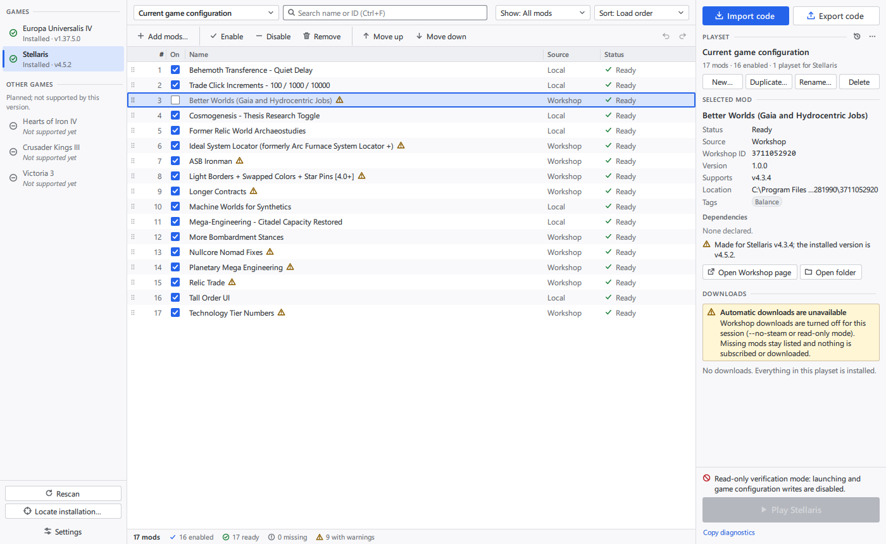

# Desktop application (`src/app`)

`pmm-app` is the Qt Quick desktop application. It composes the Qt-free
services ([`architecture-services.md`](architecture-services.md)) with the QML
user interface in `ui/` ([`ui-contract.md`](ui-contract.md)).



## Targets

| Target | Location | Qt modules | Contents |
| --- | --- | --- | --- |
| `pmm_appcore` | `src/app/core` | Core, Network | `AppRuntime` (composition root), `ServiceRunner` (worker thread), `QtWorkshopSessionHost`, `QtWorkshopMetadataHost`, `FileLogSink`, GUI-ready snapshots (`view_data.hpp`) |
| `pmm_appgui` | `src/app/gui` | Gui, Qml | `Backend` and the models and controllers of the UI contract |
| `pmm-app` | `src/app/gui/main.cpp` | Quick, QuickControls2 | start-up, command line, fatal error window, verification switches (`verification.cpp`) |

`pmm_appcore` has no GUI dependency, so a command-line front end can reuse
`AppRuntime` and `ServiceRunner` as they are. `pmm-app` is written to
`<build>/bin`, next to `pmm-steam-helper`, as in the packages.

## Processes and threads

```text
 pmm-app process
 +------------------------------------------+     +----------------------------------------+
 | GUI thread                               |     | services worker thread ("pmm-services")|
 |  QML (Pmm.Ui)                            |     |  AppRuntime                            |
 |   binds to Backend.<object>              |     |   ServiceContext, Database, journal    |
 |  Backend + models + controllers          |call |   GameService, PlaysetService,         |
 |   optimistic edits (core/playset_ops) ---+---->|   ShareService, LaunchService          |
 |   incremental model updates  <-----------+-----|   AcquisitionCoordinator               |
 |                                  results |     |  QtWorkshopSessionHost (QProcess)  ----+--> pmm-steam-helper
 |                                          |     |  QtWorkshopMetadataHost (QNetworkAM) --+--> Steam Web API
 |  acquisitionChanged / processStarting <--+-----|  QTimer ~1 s -> coordinator.tick()     |    (key-less, metadata)
 +------------------------------------------+     +----------------------------------------+
                                                    LaunchService -> platform::startDetached -> game
```

- **One worker thread** owns everything that touches services: the runtime,
  both hosts, the coordinator and its tick timer. Services are synchronous
  and not thread-safe; running them on one thread keeps them simple and
  ordered. The GUI thread never calls a service.
- **`ServiceRunner::call(receiver, fn, done)`** runs `fn(AppRuntime&)` on the
  worker and `done(result)` queued on the GUI thread. Calls run in submission
  order. A `done` whose receiver was destroyed is dropped. `callBlocking()`
  exists for start-up and tests only.
- **Results are snapshots** (`GameContextData`, `PlaysetStateData`,
  `LaunchData`, `AcquisitionData`, ...), built on the worker with strings
  already converted to `QString`. The models apply them as incremental
  updates: `dataChanged` for changed rows, `rowsInserted`/`rowsRemoved` for
  added and removed entries. Only switching to another playset resets the
  mod list.
- **Edits are optimistic.** `ModListModel` applies an edit at once with the
  same core functions the services use (`core/playset_ops`), then sends it to
  `PlaysetService`. The worker returns the authoritative state, which is
  reconciled once no other edit is in flight. Refused edits are reverted by
  that state and explained in a notification.
- **Reorders reach the view as `dataChanged`.** `QSortFilterProxyModel` turns
  source row moves into a layout change without a hint. A QML `ListView`
  then rebuilds its delegates and scrolls back to the top. The QML re-selects
  the moved rows itself.
- **Coordinator events** (helper output, helper exit, Web API replies, ticks)
  arrive on the worker and go straight to the coordinator. When job states
  change, `ServiceRunner::acquisitionChanged` makes the Backend refresh the
  downloads, the affected playset rows and the launch verdict, coalesced to
  one request at a time.

### Steam helper host

`QtWorkshopSessionHost` runs one `pmm-steam-helper --app-id <id> --steam-api
<library>` per game:

- The helper is looked up next to the executable
  (`QCoreApplication::applicationDirPath()`). The `PMM_STEAM_HELPER`
  environment variable overrides this for development.
- On Windows it starts with `CREATE_NO_WINDOW`. The process-wide error mode
  set by `main()` is inherited.
- Commands are written to stdin. Stdout is split with
  `providers::LineSplitter` and decoded with `providers::decodeEvent()`;
  undecodable lines are logged and skipped. Stderr can contain the user's
  SteamID, so it is logged at debug level only, with SteamIDs and personal
  paths redacted.
- All process signals use queued connections and are checked against a
  per-session serial number. Nothing is delivered re-entrantly from
  `open()`, `send()` or `close()`, and nothing of a session arrives after
  `close()`.
- `close()` sends `QuitCommand`, closes stdin and kills the process if it is
  still running after 3 s. A new session for the same game first waits for
  the previous helper to exit.

### Web API host

`QtWorkshopMetadataHost` posts `providers::buildPublishedFileDetailsRequest()`
to `https://api.steampowered.com/ISteamRemoteStorage/GetPublishedFileDetails/v1/`:

- It sends no API key and no cookies, and collects no telemetry.
- Requests time out after 15 s. Replies larger than the parser's limit are
  aborted.
- Failures are logged and not answered (offline operation).
- `PMM_WORKSHOP_METADATA_URL` overrides the endpoint (tests, local stubs).
- It only runs for acquisition jobs, to show names and reject items of the
  wrong game.

## Start-up sequence

1. `main()` sets the Windows error mode (`SEM_FAILCRITICALERRORS |
   SEM_NOGPFAULTERRORBOX | SEM_NOOPENFILEERRORBOX`), creates the
   `QGuiApplication`, selects the Basic Quick Controls style and parses the
   command line.
2. `main()` takes the profile lock (`ProfileLock`, a `QLockFile` on
   `<data folder>/pmm-app.lock`) and holds it until the runner has shut down.
   The journal, the acquisition jobs and the Steam helper sessions assume one
   instance per profile. A second start on the same profile waits up to 2 s
   for the lock, then shows "already running for this profile" in the error
   window (verification runs: stderr, exit code 2). A lock left by a crashed
   process is recognised by its process id and taken over. Every run takes
   the lock, read-only and verification runs included.
3. `ServiceRunner::start()` starts the worker and creates `AppRuntime` on it
   (`main()` blocks until this is done):
   1. The application folders are resolved: `AppPaths::standard()`, or
      `fromProfileDir()` with `--profile`. They are created if needed.
   2. The file log sink is installed: `pmm-app-<UTC date>.log` in the logs
      folder. A file is continued as `-2`, `-3`, ... beyond 8 MiB, and the
      newest 10 files are kept. Debug records are written with `--verbose`.
   3. `state.sqlite` is opened. A database written by a newer version, or a
      file that is not a usable database, is a fatal start-up error.
      `main()` then shows a minimal QML error window with the actionable
      message. After an upgrade, a startup notice names the backup copy.
   4. The configuration-transaction journal is created, and the
      `ServiceContext` is built with the real adapters, the discovery
      environment and the system clock, process and fingerprint functions.
      The process starter is wrapped to report "starting" to the UI.
   5. The services are created. The acquisition coordinator exists only
      when Steam is enabled for the session.
   6. Retention runs: playset history older than 30 days is purged (the
      newest 10 entries per playset are kept), finished acquisition jobs
      older than 7 days are removed, and the newest 10 finished configuration
      transactions are kept.
   7. Interrupted configuration transactions are **not** recovered. They
      produce a startup notice, block launching (`LaunchService::check`) and
      are offered as **Recover** next to Play.
4. `Backend::initialize()` loads the UI settings, the cached game states and
   the initial game's context from the database. The initial game is
   `--game`, else the last selected game, else the first installed supported
   game. Then the window is created
   (`qmlRegisterSingletonInstance("Pmm.Backend", ...)`,
   `engine.loadFromModule("Pmm.Ui", "Main")`). The first frame already shows
   the last active playset. The engine has no network access: its
   `OfflineNetworkAccessManagerFactory` (`network_guard.hpp`) refuses every
   URL except `qrc:`, `data:` and `file:` without a host, so text from share
   codes or descriptors can never become a request.
5. In the background, `GameService::refreshAll()` rediscovers the games and
   rescans the mods. With Steam enabled, the coordinator then resumes the
   unfinished jobs of every supported game (restart reconciliation; a helper
   is only started when there is such a job). The context is reloaded and
   `Backend::initialRefreshFinished()` is emitted.

On quit, the settings are saved. `ServiceRunner::shutdown()` then stops the
tick, persists acquisition progress, closes every helper session
(`coordinator.shutdown()`, then the host), destroys the runtime on the worker
and joins the thread.

## Command line

| Option | Effect |
| --- | --- |
| `--profile <dir>` | Keep every application file (database, journal, logs, cache) in `<dir>` instead of the standard per-user locations. Use it for a clean, isolated profile, for example for the "import into a clean profile" acceptance step. |
| `--verbose` | Write debug-level log records (including redacted helper stderr). |
| `--game <key>` | Select this game at start-up (`stellaris`, `eu4`). |
| `--no-steam` | Never start the Steam helper. Workshop downloads are off for the session, and missing mods stay listed as missing. An import queues nothing, so a later session with Steam downloads them only after **Download missing**. |
| `--read-only` | Never write to game folders and never launch a game. Implies `--no-steam`. The launch check skips its write probes, and Play shows why it is disabled. |

### Hidden verification switches

These switches drive the real application without user input. They imply
`--read-only` and leave the profile's settings untouched. They write
progress lines prefixed with `[verify]` to stdout, and the exit code is 0 on
success.

| Option | Effect |
| --- | --- |
| `--screenshot <png>` | When the initial rescan has finished, apply the options below, wait, grab the window (1400x860 at scale factor 1) and quit. |
| `--screenshot-delay-ms <n>` | Settle time before the grab (default 1500). |
| `--theme light\|dark` | Theme for the capture. |
| `--open <what>` | Open `export`, `add-mods`, `settings`, `history`, `locate` or `import:<code file>` before the capture. Can be repeated. |
| `--select-row <n>`, `--filter <status>`, `--search <text>` | Select a row, or set the mod list filter or search. |
| `--self-test <steps>` | Run comma-separated steps through the Backend, like the UI does: `config` (playset from the game's current configuration), `disable:<row>`, `move:<from>:<to>`, `export:<file>`, `import:<file>` (preview, then import as a new playset), `dump:<file>` (the active playset's identities, order and enabled flags as JSON). |

The share-code round trip between two clean profiles, run against this
machine's real Stellaris installation (read-only):

```sh
pmm-app --profile A --game stellaris \
        --self-test "config,disable:2,move:0:5,move:16:1,export:code.txt,dump:a.json"
pmm-app --profile B --game stellaris --self-test "import:code.txt,dump:b.json"
cmp a.json b.json   # identical identities, order and enabled flags
```

On 2026-10-29 this produced identical dumps: 17 entries, 1 disabled, Workshop
and local mods, non-default order.

The screenshots in `docs/screenshots/app-*.png` were taken with
`--screenshot` against Stellaris 4.5.2 and EU4 1.37.5 on Windows 11, with
temporary profiles. The Play area therefore shows the read-only blocker.

| File | State |
| --- | --- |
| `app-main-light.png`, `app-main-dark.png` | Stellaris playset from the game's configuration, one entry disabled and reordered, a Workshop mod selected |
| `app-filtered.png` | status filter "Disabled": reordering is off, with the explanation |
| `app-export.png` | export dialog with the share code |
| `app-add-mods.png` | installed Stellaris mods, playset members marked |
| `app-import-preview.png` | the exported code previewed in a clean profile |
| `app-eu4.png` | EU4 playset from the game's `dlc_load.json` |

## Files and folders

| What | Default (Windows) | With `--profile <dir>` |
| --- | --- | --- |
| Database | `%APPDATA%\ParadoxModManager\state.sqlite` | `<dir>\state.sqlite` |
| Configuration journal and backups | `%APPDATA%\ParadoxModManager\transactions\` | `<dir>\transactions\` |
| Logs | `%LOCALAPPDATA%\ParadoxModManager\logs\` | `<dir>\logs\` |
| Cache | `%LOCALAPPDATA%\ParadoxModManager\cache\` | `<dir>\cache\` |

The Linux and macOS locations are listed in
[`architecture.md`](architecture.md) (section "State and file locations").
Settings → About shows the folders of the running profile and opens the logs
folder. Qt keeps its own graphics pipeline cache in the standard per-user
cache folder (`ParadoxModManager/Paradox Mod Manager/cache`), even with
`--profile`.

UI settings (theme, window geometry, pane and column widths) are stored in
the database's settings table under `ui.*`, next to the services' keys
(`app.lastGameKey`, `game.<key>.activePlaysetId`). The window geometry is
saved when the window closes and when the application quits.

## Running from the build tree

On Windows, Qt's DLLs must be found: put `<Qt>/bin` on `PATH`, or install.
The tests do this themselves (`DL_PATHS` in `tests/app/CMakeLists.txt`).
`cmake --install build/<preset> --prefix <dir>` installs `bin/pmm-app` next to
`bin/pmm-steam-helper` and runs Qt's deployment script. Because `Pmm.Ui` is
a static module, the script's QML import scan is pointed at `ui/controls`,
`ui/panes` and `ui/dialogs` (`QT_QML_IMPORT_SCANNER_EXTRA_ROOT_PATHS`). On
2026-10-29 the installed debug tree ran without Qt on `PATH`.

```sh
cmake --preset debug && cmake --build --preset debug
PATH="/c/Qt/6.10.3/msvc2022_64/bin:$PATH" build/debug/bin/pmm-app.exe --profile /tmp/pmm-profile
ctest --preset debug -L pmm_app_tests
```

## Tests

`tests/app` (`pmm_app_tests`, label `pmm_app_tests`) runs on the offscreen
platform:

- model invariants with `QAbstractItemModelTester`, and incremental updates
  without resets;
- `ServiceRunner` ordering, threads, dropped results and shutdown;
- Backend edits through persistence and undo, playset management, the
  share-code round trip, and settings restore, in a temporary profile with a
  folder-scanning adapter double; row edits made while an undo is in flight,
  replies superseded by later requests, and imports with downloads off;
- a 2,000-entry playset with a time budget for each GUI-thread operation;
- the real QML module against the real Backend, without QML warnings, with a
  playset and a mod named like rich text with a remote image: nothing tries
  to load it;
- a source check of `ui/` (`ui_text_tests.cpp`): every text element whose
  text is not a fixed literal uses `textFormat: Text.PlainText`;
- the QML engine's network access refusing everything but local resources;
- `QtWorkshopSessionHost` with the real `pmm-steam-helper` and the fake Steam
  API library, including subscribe, download and install through the
  coordinator;
- `QtWorkshopMetadataHost` against a local HTTP stub;
- `AppRuntime` start-up failures, retention and interrupted transactions;
  the profile lock.

Nothing in these tests touches a real game, Steam folder or the Steam client.
