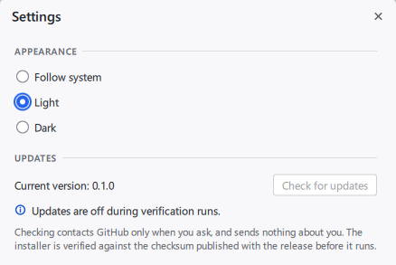

# Updates

Settings → Updates has a "Check for updates" button. An installed copy can
then update itself; a ZIP copy or a development build is pointed at the release
page. This page says what is contacted, what is verified and what that does
and does not protect against.

Code: `services/app_update` (Qt-free decisions, unit tested),
`app/core/update_client` (the network), `app/gui/update_controller`
(`Backend.updates`, see [`ui-contract.md`](ui-contract.md)). The installer's
side of the contract is in [`packaging.md`](packaging.md).



## What is contacted, and when

Nothing touches the network until the user presses a button: there is no check
at start-up, no background check, no telemetry, no token and no cookie.

| When | Request | Host |
| --- | --- | --- |
| "Check for updates" | `GET /repos/Giorgi-Apriashvili/pdx-mod-manager/releases/latest` | `api.github.com` |
| "Update and restart" | `SHA256SUMS.txt` of the release, then the installer | `github.com`, which redirects to `release-assets.githubusercontent.com` or `objects.githubusercontent.com` |
| "Open release page" | the browser opens `https://github.com/<repository>/releases/tag/v<version>` | `github.com` |

The requests carry a `User-Agent: ParadoxModManager/<version>` (GitHub requires
one) and nothing else about the user. GitHub sees the address they come from,
like any other web request. A check gives up after 15 s.

`--read-only` and the verification switches turn the feature off entirely, with
the reason shown in its place. A development build whose version is not a plain
`<major>.<minor>.<patch>` has it off too.

The hosts, the scheme and the limits live in an options struct that only C++
tests can reach. There is no environment variable or command-line switch that
changes where a shipped build connects. The repository comes from one place,
`HOMEPAGE_URL` in the root `CMakeLists.txt`.

## What is decided from a reply

The reply of the API is untrusted input, read with a size limit of 1 MiB:

- A release flagged as draft or prerelease is ignored. HTTP 404 means no release
  has been published yet, which is a normal outcome and not an error.
- The tag must be exactly `v<major>.<minor>.<patch>`: no suffix such as
  `v0.1.0-rc1`, no leading zeros.
- Only a strictly newer version is offered, never an equal or older one.
- Only two assets are ever used, found by their exact names:
  `ParadoxModManager-<version>-windows-x86_64-setup.exe` and `SHA256SUMS.txt`.
  Each URL must be exactly
  `https://github.com/<repository>/releases/download/v<version>/<name>`. A listed
  asset with another URL rejects the whole reply.
- Wrong types, missing fields, or the same asset listed twice reject the reply.
- Release notes and every other field are not read, and nothing from the reply
  is rendered. The release page's address is built from the fixed repository and
  the parsed version, never taken from the reply.
- A release without the installer or the checksum file is still offered, through
  its release page.

Every redirect is checked before it is followed, up to 5 per request: only
`https` on `github.com`, `release-assets.githubusercontent.com` or
`objects.githubusercontent.com`, without a port or user information.

## What is verified before anything runs

1. `SHA256SUMS.txt` (at most 64 KiB) is parsed strictly: `<64 lowercase hex>`,
   two spaces, a plain file name, LF line ends, every name once. Anything else
   rejects the file, and so does a file without the installer's entry. The
   installer is not fetched in these cases.
2. The installer (at most 512 MiB; a stalled download times out after 30 s) is
   written to a temporary file in `<cache>/updates` and hashed while it streams.
3. Only if the SHA-256 matches does the file get its final name. A mismatch
   deletes it, and nothing is started.
4. Right before the start the digest is computed again, because the file has
   been sitting in a folder of this user since it was verified.
5. Workshop downloads in progress and a game launch in progress hold the start
   back with the reason shown, also when they begin while the services worker is
   still answering. "Install and restart" then continues without downloading
   again. A job the worker has not started yet when it answers is not seen; it stops
   with the application and continues after the restart, as jobs do at any quit.

The folder is `updates` under the cache folder of the running profile, so
`--profile` stays isolated. Every file in it is disposable: it is emptied at
start-up (except in read-only and verification sessions) and before a download.

## The update run

An installed copy is recognised by `<folder of pmm-app.exe>/../unins000.exe`. It
starts the verified installer with exactly

```text
/SILENT /SP- /NORESTART /PMMUPDATE=1
```

and quits through the normal path, so settings are saved. If the start fails, the
application keeps running and reports it. The process holds the named mutex
`Local\ParadoxModManagerRunning` for its whole lifetime, verification runs
included; the installer waits for it, installs over the existing folder and
starts the application again. User data lives outside the install folder. If the
installer cannot finish, it says so and the current version stays in place
([`packaging.md`](packaging.md#windows-installer)).

ZIP copies and development builds get "Open release page". The log
says which one a copy has, at start-up: `update mode mode=installer` or
`mode=releasePage`.

**Not verified yet:** no update between two published releases has happened, and
the `Release` workflow's publish step has not run. What has been run is listed in the
[installer evidence](evidence/installer-2026-10-30.md#after-merging-the-update-check):
the installer with these exact arguments, waiting for the real `pmm-app`, with a
stand-in program for the relaunch, and the client against a local stub and a real
GitHub asset. The button pressed in a real installed copy, and the relaunch of the
real application, have not been run.

## Threat model

Protected:

- **Corruption and tampering in transit.** TLS protects the connection and the
  checksum detects a changed installer. A download that does not match is
  deleted without being run.
- **A hostile reply or redirect** sending the application elsewhere: wrong hosts,
  lookalikes such as `github.com.evil.example`, other repositories, plain `http`,
  traversal in names and oversized replies are refused.
- **A downgrade**: only strictly newer versions are offered.

Not protected:

- **A compromised GitHub account or repository.** The checksum file comes from the
  same release as the installer. Whoever can publish a release can publish a
  matching pair, and the application would install it. A checksum from the same
  place detects accidents and interference on the way, not a malicious publisher.
- **A compromised machine.** Anything that can write to the user's folders can
  replace the file between the last check and the start, or replace the
  application itself.

The installer is **not signed**. Windows cannot tell who published it, and
SmartScreen may warn about it, in particular when it is downloaded by hand.
Signing the installer and the application, and verifying the signature before
the start, would close the gap above: a stolen GitHub login would no longer be
enough to ship an update.

## Testing

- `tests/unit/services/app_update_tests.cpp`: versions, hostile release JSON, URL
  and redirect allow-lists, checksum files.
- `tests/app/update_tests.cpp`, against a local `QTcpServer` stub: the check, 404,
  malformed replies, refused redirects, checksum mismatch, cancel, size limit,
  stall timeout, the download. "Installing" starts the harmless test program
  `pmm_platform_echo` under the installer's name and checks its arguments. The
  real installer is never run by tests.
- `tests/app/qml_tests.cpp`: the Settings section against the real backend, with
  the keyboard, at the smallest window size.
- `pmm_app_tests "[.live-update]"`, by hand only: one unauthenticated request to
  the real API through the client. CTest does not run it.
