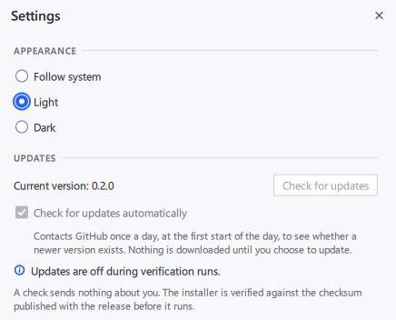

# Updates

The application checks GitHub for a new version once a day by itself, and
Settings → Updates has a "Check for updates" button. An installed copy can then
update itself; a ZIP copy or a development build is pointed at the release page.
This page says what is contacted, what is verified, which values every released
copy depends on ([the compatibility contract](#compatibility-contract-frozen-since-010)),
and what that does and does not protect against.

Code: `services/app_update` (Qt-free decisions, unit tested),
`app/core/update_client` (the network), `app/gui/update_controller`
(`Backend.updates`, see [`ui-contract.md`](ui-contract.md)). The installer's
side is in [`packaging.md`](packaging.md#windows-installer). The frozen values are
written down once, in [`packaging/update-contract.txt`](../packaging/update-contract.txt),
and [`scripts/check-update-contract.sh`](../scripts/check-update-contract.sh) checks
them everywhere.



## What is contacted, and when

| When | Request | Host |
| --- | --- | --- |
| Once a day ([below](#the-daily-check)), and "Check for updates" | `GET https://api.github.com/repositories/1439071956/releases/latest`; a redirect is not followed | `api.github.com` |
| "Update and restart" | `SHA256SUMS.txt` of the release, then the installer | `github.com`, which redirects to a host under `githubusercontent.com` |
| "Open release page" | the browser opens `https://github.com/<owner>/<repository>/releases/tag/v<version>`, with the owner and repository of the checked reply ([below](#what-is-decided-from-a-reply)) | `github.com` |

The requests carry a `User-Agent: ParadoxModManager/<version>` (GitHub requires
one) and nothing else about the user: no token, no cookie, no telemetry. GitHub
sees the address they come from, like any other web request. A check gives up after
15 s.

`--read-only` and the verification switches turn the feature off entirely, the
daily check included, with the reason shown in its place. A development build whose
version is not a plain `<major>.<minor>.<patch>` has it off too. A session started
with `--profile` or `--no-steam` can check, but not install: "Update and restart"
is unavailable there with the reason "Restart Paradox Mod Manager without --profile
or --no-steam to update.", and the release page stays available. The installer
starts the new version without arguments, so it would come back in the standard
profile, with Steam, and a 0.1.0 session has no way to pass its own arguments on.

The hosts, the scheme and the limits live in an options struct that only C++
tests can reach. There is no environment variable or command-line switch that
changes where a shipped build connects. The repository is GitHub's numeric id
1439071956, defined once as `PMM_GITHUB_REPOSITORY_ID` next to `HOMEPAGE_URL` in the
root `CMakeLists.txt`. The id stays the same when the repository is renamed or
transferred, and whoever registers an old name cannot take its place. The slug in
`HOMEPAGE_URL` (`Giorgi-Apriashvili/pdx-mod-manager`) is documentation and the
literal the Release workflow compares. The updater never asks it anything and
never downloads from it; its only use is the list of releases that "Open release
page" opens while no reply in the session has named the repository (no release
published yet, or no check got an answer).

### The daily check

About 10 s after the initial refresh of games and mods has finished, the
application sends exactly the request of the "Check for updates" button, once, if
all of these hold:

- the setting "Check for updates automatically" in Settings > Updates is on (the
  default). It is stored with the other settings, in the settings table of the
  profile's database, and the section explains that it contacts GitHub once a day;
- the session is not read-only or a verification run;
- the build's version is a plain `<major>.<minor>.<patch>`;
- no automatic check has completed on the current local calendar date.

The local date is recorded when the request ends with any answer from GitHub: a
newer version, up to date, no release yet, or an HTTP error. A network failure
records nothing, so the next start on the same day tries again. Failures are not
shown, only logged.

When a newer version is found, the main window shows a banner that does not block
anything: "Paradox Mod Manager <x.y.z> is available." with "Update and restart"
(installed copy) or "Open release page" (ZIP or development copy), and "Not now",
which hides it for the rest of the session. Nothing is downloaded or installed
without that click.

## What is decided from a reply

The reply of the API is untrusted input, read with a size limit of 1 MiB:

- The request does not follow redirects. GitHub answers a request by repository id
  directly, also after a rename or transfer; a redirect answer counts as an error.
- A release flagged as draft or prerelease is ignored. HTTP 404 means no release
  has been published yet, which is a normal outcome and not an error.
- Owner and repository are taken from the reply itself: its `url` must be
  `https://api.github.com/repos/<owner>/<repository>/releases/<digits>` and its
  `html_url` `https://github.com/<owner>/<repository>/releases/tag/v<version>`, both
  naming the same owner and repository (GitHub's name rules, compared without
  regard to case). Anything else rejects the reply.
- The tag must be exactly `v<major>.<minor>.<patch>`: no suffix such as
  `v0.1.0-rc1`, no leading zeros.
- Only a strictly newer version is offered, never an equal or older one.
- Only two assets are ever used, found by their exact names:
  `ParadoxModManager-<version>-windows-x86_64-setup.exe` and `SHA256SUMS.txt`.
  Each `browser_download_url` must be exactly
  `https://github.com/<owner>/<repository>/releases/download/v<version>/<name>`,
  with the owner and repository checked above. A listed asset with another URL
  rejects the whole reply.
- Wrong types, missing fields, or the same asset listed twice reject the reply.
- Release notes and every other field are not read, and nothing from the reply
  is rendered. The release page's address is built from the checked owner,
  repository and version, never copied from the reply. The application keeps the
  owner and repository of the last reply for the session, so the page after a
  failed download, or the list of releases after a later check that failed, is in
  that repository too.
- A release without the installer or the checksum file is still offered, through
  its release page.

Downloads (never the API request) follow up to 5 redirects, each checked before it
is followed: `https` only, no user information, no explicit port, and the host is
`github.com` or ends in `.githubusercontent.com` at a label boundary
(`release-assets.githubusercontent.com` is allowed, `evilgithubusercontent.com` and
`githubusercontent.com.evil.example` are not).

## What is verified before anything runs

1. `SHA256SUMS.txt` (at most 64 KiB) is parsed strictly: `<64 lowercase hex>`,
   two spaces, a plain file name, LF line ends, every name once. Anything else
   rejects the file, and so does a file without the installer's entry. The
   installer is not fetched in these cases.
2. The installer (at most 512 MiB; a stalled download times out after 30 s) is
   written to a temporary file in `<cache>/updates` and hashed while it streams.
3. Only if the SHA-256 matches does the file get its final name. A mismatch
   deletes it, and nothing is started. When the final save fails, for example
   because a virus scanner still has the file open, it is retried a few times over
   about a second before the download fails with "The installer could not be saved
   (the file is in use or the disk is full). Try again."
4. Right before the start the digest is computed again, because the file has
   been sitting in a folder of this user since it was verified.
5. Workshop downloads in progress and a game launch in progress hold the start
   back with the reason shown, also when they begin while the services worker is
   still answering. "Install and restart" then continues without downloading
   again. A job the worker has not started yet when it answers is not seen; it stops
   with the application and continues after the restart, as jobs do at any quit.

The folder is `updates` under the cache folder of the running profile. Every file
in it is disposable: it is emptied at start-up (except in read-only and
verification sessions) and before a download.

## The update run

An installed copy is recognised by `<folder of pmm-app.exe>/../unins000.exe`, that
is `..\unins000.exe` from `bin\pmm-app.exe`. It starts the verified installer with
exactly

```text
/SILENT /SP- /NORESTART /PMMUPDATE=1
```

and quits through the normal path, so settings are saved. If the start fails, the
application keeps running and reports it. The process holds the named mutex
`Local\ParadoxModManagerRunning` for its whole lifetime, verification runs
included; the installer waits for it, installs over the existing folder and
starts `bin\pmm-app.exe` again, without arguments. User data lives outside the
install folder. If the update is cancelled or fails after the application has
quit, the installer puts the previous version back and starts it again; if it
cannot put it back, it says so and names its own file to run again
([`packaging.md`](packaging.md#windows-installer)). A setup never replaces a newer
installed version, also not in an update run.

ZIP copies and development builds get "Open release page". The log
says which one a copy has, at start-up: `update mode mode=installer` or
`mode=releasePage`.

**Verified 2026-11-07:** the owner's installed 0.1.0 updated itself to the published
0.1.1 with **Update and restart**, the first update between two published releases,
and the same copy then updated itself from 0.1.1 to 0.1.2 (reported 2026-11-12).
What had been run before is listed in the
[installer evidence](evidence/installer-2026-10-30.md#after-merging-the-update-check):
the installer with these exact arguments, waiting for the real `pmm-app`, with a
stand-in program for the relaunch, and the client against a local stub and a real
GitHub asset. Since 2026-11-06 the installer smoke test on the GitHub runner also
runs an update run with these arguments against a held mutex and checks that it
starts the installed `pmm-app.exe`; it passed on 2026-11-06.

## Compatibility contract (frozen since 0.1.0)

Every copy of 0.1.0 has its updater compiled in, and that updater is how most users
will get every later version: they will not come back to GitHub to look. So every
later release has to keep what 0.1.0 relies on, forever, or the copies out there
stop updating and nothing can reach them to fix it. The values below are frozen.
They are written down once in
[`packaging/update-contract.txt`](../packaging/update-contract.txt);
[`scripts/check-update-contract.sh`](../scripts/check-update-contract.sh) fails CI
when a source drifts from them, and the Release workflow checks a release against
them before it exists ([`releasing.md`](releasing.md#the-update-contract)).

| Value | Frozen as | Why |
| --- | --- | --- |
| Where copies ask | `https://api.github.com/repositories/1439071956/releases/latest`, no redirects | The only address a copy ever asks. The numeric id survives renames and transfers, and a new owner of an old name cannot answer for the project. Every release must be published in this repository; a project moved to a new repository (rather than transferred) would strand every copy. |
| Authentication | none: no token, no cookie | Nothing secret can live in a shipped program. GitHub allows 60 unauthenticated requests per hour from an address; one a day plus the button is far below. |
| Release channel | `releases/latest` only | That endpoint returns the newest published release that is neither a draft nor a pre-release. A pre-release or a draft never reaches a copy, so publish complete releases only (the workflow fills a draft first). |
| Tag and version | `v<version>`, the version matching `version_regex` below, each part at most 65535, strictly higher than every earlier release | Copies parse exactly this and reject anything else; an equal or older version is never offered. 65535 is the limit of Windows version resources and of Inno Setup's version comparison. |
| Installer asset | `ParadoxModManager-<version>-windows-x86_64-setup.exe`, at most 512 MiB (536870912 bytes) | Found by this exact name; a larger file is refused while it downloads. |
| Checksum asset | `SHA256SUMS.txt`, at most 64 KiB (65536 bytes), lines matching `checksum_line_regex` below | Parsed strictly: LF line ends, no BOM, no blank or comment lines, every name once, the installer listed. Any other line rejects the whole file, and then nothing is installed. |
| Asset names | `asset_name_regex` below, never containing `..` | Every name in `SHA256SUMS.txt` must be a plain file name, and GitHub renames assets with other characters. |
| Setup arguments | `/SILENT /SP- /NORESTART /PMMUPDATE=1`, exactly | What a copy starts the verified setup with. Every later setup must accept them: `PMMUPDATE=1` is what makes it wait for the application and start it again. |
| Running signal | the mutex `Local\ParadoxModManagerRunning` | Held by every copy while it runs; the setup waits until no process holds it. |
| Installation identity | Inno Setup `AppId` `{25EA6705-9979-4D3F-AF89-BE3398B30CA0}` | Ties a new setup to the existing installation, its folder, its uninstall entry and the version check that refuses a downgrade. |
| Installation scope | per user, `PrivilegesRequired=lowest`, no choice of mode | A copy starts the setup without administrator rights; a setup that asked for them would put up a UAC prompt or install somewhere else. |
| Layout | the application at `bin\pmm-app.exe`, an installation recognised by `..\unins000.exe` from there | How a copy decides between "Update and restart" and the release page, and what the setup starts after an update run. |
| TLS | `plugins\tls\qschannelbackend.dll` in every package | Qt's Schannel backend carries every HTTPS request. A release without it could never check for updates again, and its users would be stranded. |

The grammars, exactly as in the contract file:

```text
version_regex       = ^(0|[1-9][0-9]*)\.(0|[1-9][0-9]*)\.(0|[1-9][0-9]*)$
asset_name_regex    = ^[A-Za-z0-9._+-]+$
checksum_line_regex = ^[0-9a-f]{64}  [A-Za-z0-9._+-]+$
```

**What GitHub has to keep doing**, which no release can freeze: answer
`/repositories/<id>/releases/latest` without authentication and without a redirect;
keep the fields `url`, `html_url`, `tag_name`, `draft`, `prerelease`, `assets[].name`
and `assets[].browser_download_url` in the shapes above; serve release assets from
`github.com` with redirects over `https` to hosts under `githubusercontent.com`; and
use TLS that Windows' Schannel on Windows 10 1809 accepts. If that changes, copies
fail to check or download and say so; the way out is then the release page and the
setup by hand, as the README describes.

**Changing the contract** is not possible for copies that are already out there.
If a value ever has to change, the release that changes it must still satisfy the
old contract (same address, names, arguments and so on), and carry the new one in
its application; releases have to keep satisfying the old one for as long as old
copies matter. A version number is never reused, and a bad release is replaced by a
higher one ([`releasing.md`](releasing.md#withdrawing-a-bad-release)).

## Threat model

Protected:

- **Corruption and tampering in transit.** TLS protects the connection and the
  checksum detects a changed installer. A download that does not match is
  deleted without being run.
- **A hostile reply or redirect** sending the application elsewhere: wrong hosts,
  lookalikes such as `github.com.evil.example` or `evilgithubusercontent.com`,
  other repositories, plain `http`, traversal in names and oversized replies are
  refused.
- **A repository name taken over.** Copies ask by repository id, so whoever
  registers a name the project used before cannot publish to them.
- **A downgrade**: only strictly newer versions are offered, and a setup does not
  replace a newer installed version.

Not protected:

- **A compromised GitHub account or repository.** The checksum file comes from the
  same release as the installer. Whoever can publish a release can publish a
  matching pair, and the application would install it. A checksum from the same
  place detects accidents and interference on the way, not a malicious publisher.
- **A compromised machine.** Anything that can write to the user's folders can
  replace the file between the last check and the start, or replace the
  application itself.

The installer is **not signed**. Windows cannot tell who published it, and
SmartScreen may warn about it, in particular when it is downloaded by hand.
Signing the installer and the application, and verifying the signature before
the start, would close the gap above: a stolen GitHub login would no longer be
enough to ship an update.

## Testing

- `tests/unit/services/app_update_tests.cpp`: versions, hostile release JSON, URL
  and redirect allow-lists, checksum files.
- `tests/app/update_tests.cpp`, against a local `QTcpServer` stub: the check, 404,
  malformed replies, refused redirects, a renamed repository and its release page,
  checksum mismatch, cancel, size limit, stall timeout, the locked final save, the
  download. "Installing" starts the harmless test program `pmm_platform_echo` under
  the installer's name and checks its arguments. The real installer is never run
  by tests.
- `tests/app/update_auto_tests.cpp`, on the same stub with an injected calendar:
  the daily check once per local date, no record after a network failure, the
  date recorded after any HTTP answer, the setting, read-only and verification
  sessions, and the release page in `--profile` and `--no-steam` sessions.
- `tests/app/qml_tests.cpp`: the Settings section and the banner against the real
  backend, with the keyboard, at the smallest window size.
- `pmm_app_tests "[.live-update]"`, by hand only: one unauthenticated request to
  the real API through the client. CTest does not run it.
- [`scripts/check-update-contract.sh`](../scripts/check-update-contract.sh) and its
  test [`scripts/test-update-contract.sh`](../scripts/test-update-contract.sh), in
  CI's "Format check" job: the code of the sources against the contract (a value
  left only in a comment does not count), and mutated copies, versions and release
  assets that must fail.
- [`smoke-test-installer.ps1`](../packaging/windows/smoke-test-installer.ps1), on the
  GitHub runner only: the installer's side, including update runs with the exact
  arguments and the relaunch of the real `pmm-app.exe`
  ([`packaging.md`](packaging.md#windows-installer)).
