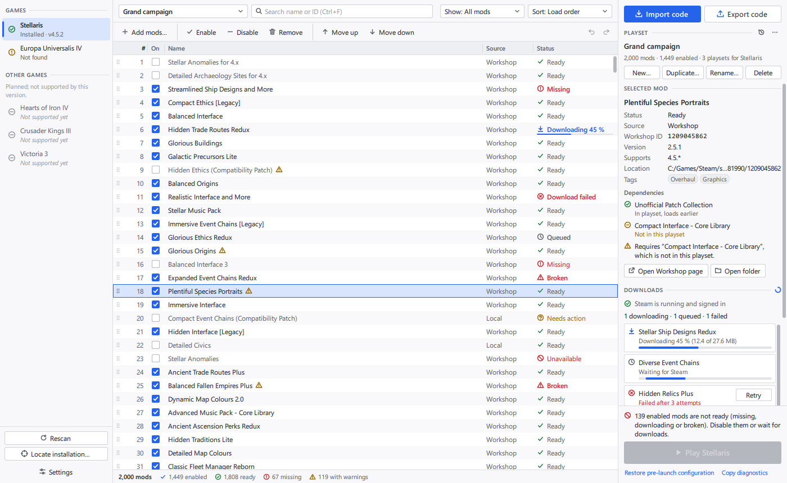

# ui/ - Qt Quick presentation layer

QML only: it binds to the C++ objects described in
[`docs/ui-contract.md`](../docs/ui-contract.md) and calls their invokables. No
domain logic lives here.



## Structure

| Path | Contents |
|---|---|
| `CMakeLists.txt` | Static QML module `Pmm.Ui` 1.0 (`pmm_ui` + `pmm_uiplugin`) |
| `Main.qml` | `ApplicationWindow`: the three-column `SplitView`, dialogs, global shortcuts, toasts, geometry persistence |
| `Theme.qml` | Singleton: light/dark palettes (follows `Backend.settings.effectiveDark`), type scale, metrics, status glyph mapping, small helpers |
| `controls/` | Restyled Basic controls (`AppButton`, `AppComboBox`, `AppTextField`, `AppDialog`, ...) and small building blocks (`Banner`, `Icon`, `FocusRing`, `SectionHeader`, ...) |
| `panes/` | `GamesPane` (left), `ModsPane` + `ModRow` + `ModColumnHeader` (center), `SidePane` with `PlaysetSection`, `DetailsSection`, `DownloadsSection`, `PlaySection` (right), `ToastHost` |
| `dialogs/` | Import, export, add mods, history, locate installation, settings, confirm, name |
| `dev/` | Preview-only fake backend, preview/screenshot/test harness. Not part of the build |

Icons are vector paths on a 16x16 grid (`controls/IconPaths.js`) drawn with
`QtQuick.Shapes`, so they stay sharp at any scale factor. Status is always a
distinct glyph plus text, never colour alone.

## Integration with the application

The app target links `pmm_uiplugin`, uses `Q_IMPORT_QML_PLUGIN(Pmm_UiPlugin)`,
registers the backend with
`qmlRegisterSingletonInstance("Pmm.Backend", 1, 0, "Backend", backend)` and
calls `engine.loadFromModule("Pmm.Ui", "Main")`. `Pmm.Backend` is resolved at
run time only; it is not a build dependency of this module.

Build just the module:

```sh
cmake --preset debug
cmake --build --preset debug --target pmm_ui pmm_uiplugin
```

Things the QML relies on beyond the tables in the contract:

- String-list roles/properties (`warnings`, `blockers`, `tags`, ...) may be a
  `QStringList`; `Theme.lines()` also accepts a newline-separated string.
- Backend properties are observed through bindings, so any NOTIFY signal name
  works. Model updates use the normal `QAbstractItemModel` signals. Mod list
  edits apply synchronously, and reorders arrive as `dataChanged` (a proxy
  model would turn moves into a layout reset that scrolls the list to the
  top), so the panes re-select moved rows themselves right after a move.
- Results of service work arrive asynchronously: the export code through
  `sharing.lastExportCode`, dependency feedback through
  `mods.dependencyFeedback(text)`, previews through `sharing.preview`.
- `ModFilterModel.index(row, 0)` (inherited from `QAbstractItemModel`) feeds an
  `ItemSelectionModel` for multi-select.
- Object names for automation: `modsPane`, `modList`, `searchField`,
  `statusFilter`, `sortSelector`, `playsetSelector`, `columnHeader`,
  `dragHandleArea`, `playButton`, `importDialog`, `importNameField`,
  `importConfirmButton`, `confirmDialog`, `confirmButton`.

## Interaction reference

| Key | Action |
|---|---|
| Up / Down, PgUp / PgDn, Home / End | Move the current row (Shift extends the selection) |
| Ctrl / Shift + click | Toggle / extend the selection |
| Space | Toggle enabled for the current row or the selection |
| Ctrl+Up / Ctrl+Down | Move the selection earlier / later in the load order |
| Delete | Remove the selection from the playset (asks first; undoable) |
| Ctrl+A | Select all visible rows |
| Ctrl+F, Esc | Focus search; Esc clears it, a second Esc returns to the list |
| Ctrl+Z, Ctrl+Shift+Z / Ctrl+Y | Undo / redo playset edits |
| Ctrl+I, Ctrl+E | Import / export a share code |
| Ctrl+N, Ctrl+Shift+A | New playset / add mods |
| F5, Ctrl+, | Rescan / settings |
| Menu key, right click | Row context menu |

Reordering (drag handle, Move up/down, Ctrl+Up/Down) is only possible in the
unfiltered load-order view (`modView.reorderAllowed`); otherwise a slim banner
shows `reorderBlockedReason` with a "Show load order" action. Column widths are
dragged in the header; Name takes the remaining width. Window geometry, pane
widths and column widths are written to `Backend.settings` and saved on close.

## Preview without the application

`dev/Pmm/Backend` is a QML-only stand-in for the whole contract surface:
2,000 synthetic mods in all states (missing, queued, downloading, failed,
unavailable, broken, warnings), Stellaris installed, EU4 not found, three
unsupported games, download jobs, history snapshots and an import preview.
Nothing is read from or written to disk.

```sh
export QT_ROOT_DIR=C:/Qt/6.10.3/msvc2022_64   # or put qml/qmllint on PATH
ui/dev/preview.sh                # interactive window
ui/dev/preview.sh --screenshot   # regenerate docs/screenshots/*.png (1400x860)
ui/dev/preview.sh --test         # QML smoke tests (qmltestrunner, dev/tests)
ui/dev/preview.sh --lint         # qmllint on every module file
```

No C++ build is needed: the script generates `build/ui-preview/Pmm/Ui/qmldir`
from the `QML_FILES` list in `CMakeLists.txt`, pointing at the source files, so
edits show up on the next run. (The qmldir that the CMake build writes declares
the static `pmm_uiplugin`, which the stock `qml` tool cannot load.) New QML
files therefore only need to be added to `CMakeLists.txt`.

The screenshot and test runs open a real window for a few seconds; the
`offscreen` platform has no fonts on Windows. Screenshots are taken at a fixed
scale factor of 1 so they are exactly 1400x860 regardless of the display.

## Screenshots

`docs/screenshots/`: `main-light`, `main-dark`, `main-filtered` (reorder
disabled banner), `import-preview` / `import-preview-dark`, `export-code`
(with a toast above the dialog), `add-mods`, `settings`, `playset-deleted`
(Restore affordance), `history`, `game-not-found`.
