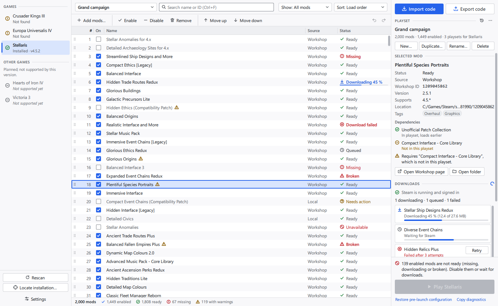

# ui/ - Qt Quick presentation layer

QML only: it binds to the C++ objects described in
[`docs/ui-contract.md`](../docs/ui-contract.md) and calls their invokables. No
domain logic lives here.



## Structure

| Path | Contents |
|---|---|
| `CMakeLists.txt` | Static QML module `Pmm.Ui` 1.0 (`pmm_ui` + `pmm_uiplugin`) |
| `Main.qml` | `ApplicationWindow`: the three-column `SplitView`, dialogs, global shortcuts, toasts, geometry persistence |
| `Theme.qml` | Singleton: light/dark palettes (follows `Backend.settings.effectiveDark`), type scale, metrics, status glyph mapping, small helpers |
| `controls/` | Restyled Basic controls (`AppButton`, `AppComboBox`, `AppTextField`, `AppDialog`, ...) and small building blocks (`Banner`, `Icon`, `FocusRing`, `SectionHeader`, ...) |
| `panes/` | `GamesPane` (left), `ModsPane` + `ModRow` + `ModColumnHeader` (center), `SidePane` with `PlaysetSection`, `DetailsSection`, `DownloadsSection`, `PlaySection` (right), `ToastHost`, `UpdateBanner` (above the columns, the daily update check's offer) |
| `dialogs/` | Import, export, add mods, history, locate installation, settings, confirm, name |
| `dev/` | Preview-only fake backend, preview/screenshot/test harness. Not part of the build |

Icons are vector paths on a 16x16 grid (`controls/IconPaths.js`) drawn with
`QtQuick.Shapes`, so they stay sharp at any scale factor. Status is always a
distinct glyph plus text, never colour alone. Keyboard access, accessible
names, announcements, contrast and high-DPI behaviour are described in
[`docs/accessibility.md`](../docs/accessibility.md).

## Integration with the application

The app target links `pmm_uiplugin`, uses `Q_IMPORT_QML_PLUGIN(Pmm_UiPlugin)`,
registers the backend with
`qmlRegisterSingletonInstance("Pmm.Backend", 1, 0, "Backend", backend)` and
calls `engine.loadFromModule("Pmm.Ui", "Main")`. `Pmm.Backend` is resolved at
run time only; it is not a build dependency of this module.

Build just the module:

```sh
cmake --preset debug
cmake --build --preset debug --target pmm_ui pmm_uiplugin
```

Things the QML relies on beyond the tables in the contract:

- Backend strings are data, never markup. A `Text` whose text is not a fixed
  literal sets `textFormat: Text.PlainText` (the default `AutoText` renders a
  name like `` as rich text and fetches the image);
  `tests/app/ui_text_tests.cpp` fails otherwise. Tool tips share one
  instance, which `Main.qml` switches to plain text.
- String-list roles/properties (`warnings`, `blockers`, `tags`, ...) may be a
  `QStringList`; `Theme.lines()` also accepts a newline-separated string.
- Backend properties are observed through bindings, so any NOTIFY signal name
  works. Model updates use the normal `QAbstractItemModel` signals. Mod list
  edits apply synchronously, and reorders arrive as `dataChanged` (a proxy
  model would turn moves into a layout reset that scrolls the list to the
  top), so the panes re-select moved rows themselves right after a move.
- Results of service work arrive asynchronously: the export code through
  `sharing.lastExportCode`, dependency feedback through
  `mods.dependencyFeedback(text)`, previews through `sharing.preview`.
- `ModFilterModel.index(row, 0)` (inherited from `QAbstractItemModel`) feeds an
  `ItemSelectionModel` for multi-select.
- Object names for automation: `gamesPane`, `modsPane`, `sidePane`,
  `gamesDivider`, `sideDivider` (the keyboard column dividers), `sidePage`
  (the actions column's scroll area), `modList`, `searchField`,
  `statusFilter`, `sortSelector`, `playsetSelector`, `columnHeader`,
  `modsToolbar` (its `compact` is true while it shows icons only),
  `modsFooter` (`compact`: counts without their words), `showingStat`,
  `dragHandleArea`, `playButton`, `interruptedBanner`,
  `discardInterruptedButton`, `settingsButton`, `importDialog`,
  `importNameField`, `importConfirmButton`, `importPreviewTitle`,
  `importListNote`, `importLookupLine`, `importEntryList`, `exportDialog`,
  `exportScroller` (its scrolling content), `copyShareCodeButton`,
  `workshopIdListField`, `workshopIdListNote`, `copyWorkshopIdListButton`,
  `confirmDialog`,
  `confirmScroller` (its scrolling text), `confirmButton`, `cancelButton`,
  `settingsDialog`, `shortcutsDialog`, `shortcutList`.
- The window's minimum size is 900x440 (it fits a 1920x1080 screen at
  200 %); `docs/accessibility.md` ("Smallest window") describes how the
  columns, the toolbar, the actions column and the dialogs adapt.
  `AppButton` elides a label that does not fit, hides it with
  `display: AbstractButton.IconOnly` (its `labelledWidth` is the width with
  the label), and with `available: false` looks disabled but keeps the focus
  and still emits `clicked()` (Play while it is blocked).
- `ResizeHandle` is the keyboard side of a column divider: a focusable
  separator (arrows, Shift, Home, End, Enter) that asks its owner for a width,
  never for the one the column already has (so a squeezed column keeps its
  stored width), and announces the new width once `value` has it; the mouse
  stays with the SplitView handle or the header edge underneath. After a drag,
  `Main.qml` keeps the chosen width of a column the drag could not widen.
- `FooterStat` shows `shortText` instead of `text` while `compact`; `text`
  stays its accessible name and tool tip.

## Interaction reference

| Key | Action |
|---|---|
| Tab / Shift+Tab, F6 / Shift+F6 | Next / previous control; next / previous column |
| Up / Down, PgUp / PgDn, Home / End | Move the current row (Shift extends the selection) |
| Ctrl / Shift + click, Ctrl+Space | Toggle / extend the selection; toggle the current row |
| Space | Toggle enabled for the current row or the selection |
| Alt+Up / Alt+Down (or Ctrl+Up / Ctrl+Down) | Move the selection earlier / later in the load order |
| Delete | Remove the selection from the playset (asks first; undoable) |
| Ctrl+A | Select all visible rows |
| Ctrl+F, Esc | Focus search; Esc clears it, a second Esc returns to the list |
| Ctrl+Z, Ctrl+Shift+Z / Ctrl+Y | Undo / redo playset edits |
| Ctrl+I, Ctrl+E | Import / export a share code or Workshop ID list |
| Ctrl+N, Ctrl+Shift+A | New playset / add mods |
| F5, Ctrl+, | Rescan / settings |
| Shift+F10, Menu key, right click | Row context menu |
| Enter / Space, Esc | Activate the focused button; close a dialog or menu (focus returns) |
| Left / Right (Shift), Home / End, Enter | On a column divider or table column edge: resize, narrowest / widest, default width |
| Ctrl+Left / Ctrl+Right | On a table column edge: previous / next edge |
| F1 | Keyboard shortcuts list |

Reordering (drag handle, Move up/down, Alt/Ctrl+Up/Down) is only possible in the
unfiltered load-order view (`modView.reorderAllowed`); otherwise a slim banner
shows `reorderBlockedReason` with a "Show load order" action. Column widths are
dragged in the header or set from the keyboard (one Tab stop before the list);
Name takes the remaining width. The column dividers are dragged or reached
with Tab at the edge of the games and actions columns. Window geometry, pane
widths (as chosen, not as squeezed by a small window) and column widths are
written to `Backend.settings` and saved on close.

## Preview without the application

`dev/Pmm/Backend` is a QML-only stand-in for the whole contract surface:
2,000 synthetic mods in all states (missing, queued, downloading, failed,
unavailable, broken, warnings), Stellaris installed, EU4 and Crusader Kings III
not found, two unsupported games, download jobs, history snapshots and an
import preview. A pasted Workshop ID list (any text not starting with `PMM`)
is previewed with its missing mods shown by ID; about a second later
(`autoLookup`, or at once with `Backend.sharing.finishLookup()`) their
Workshop names arrive in the same preview.
Nothing is read from or written to disk.

```sh
export QT_ROOT_DIR=C:/Qt/6.10.3/msvc2022_64   # or put qml/qmllint on PATH
ui/dev/preview.sh                # interactive window
ui/dev/preview.sh --screenshot   # regenerate docs/screenshots/*.png (1400x860)
ui/dev/preview.sh --test         # QML tests (qmltestrunner, dev/tests; also in ctest, label ui-preview)
ui/dev/preview.sh --lint         # qmllint on every module file
python3 ui/dev/check_contrast.py # WCAG contrast of the Theme.qml colour pairs
```

No C++ build is needed: the script generates `build/ui-preview/Pmm/Ui/qmldir`
from the `QML_FILES` list in `CMakeLists.txt`, pointing at the source files, so
edits show up on the next run. (The qmldir that the CMake build writes declares
the static `pmm_uiplugin`, which the stock `qml` tool cannot load.) New QML
files therefore only need to be added to `CMakeLists.txt`.

The screenshot runs open a real window for a few seconds; the `offscreen`
platform has no fonts on Windows. Screenshots are taken at a fixed scale
factor of 1 so they are exactly 1400x860 regardless of the display, or at an
explicitly set `QT_SCALE_FACTOR`; the real application's `--screenshot` does
the same ([`docs/app.md`](../docs/app.md#hidden-verification-switches)). The
PNGs are the window's size times the scale factor only while that fits the
screen: Windows shrinks a taller window without a warning, so with
`QT_SCALE_FACTOR=2` the 1400x860 layout needs a screen of at least 2800x1760
pixels (on a 2560x1440 screen the captures come out 2800x1422, the window
1400x711). The real application's `--window-size` picks a size that fits,
such as `--window-size 1x1` for the smallest window (1800x880 at 2).

The tests also run on the `offscreen` platform (`scripts/check.sh` sets it),
where Qt finds no fonts on Windows; they check behaviour, not text layout,
which the screenshot runs and the real window show. ctest runs them as `pmm_ui_preview` (label `ui-preview`) when Qt's
`qmltestrunner` is found: `tests/app/CMakeLists.txt` writes the same qmldir
into `<build>/ui-preview` at configure time, so `scripts/check.sh` and the
release's CI run them without bash.

## Screenshots

`docs/screenshots/`: `main-light`, `main-dark`, `main-filtered` (reorder
disabled banner), `import-preview` / `import-preview-dark`, `export-code`
(with a toast above the dialog), `add-mods`, `settings`, `playset-deleted`
(Restore affordance), `history`, `game-not-found`, `a11y-focus-light`
(keyboard focus ring and tool tip), `a11y-shortcuts-dark` (F1 list).
